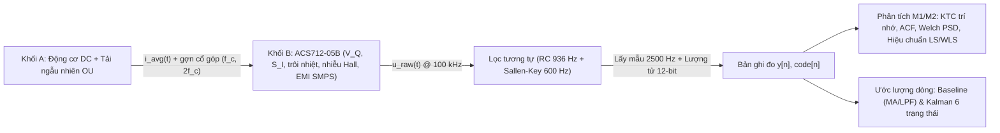

# EE6423 – Mô phỏng, Phân tích Tín hiệu Ngẫu nhiên & Hiệu chuẩn Cảm biến Dòng Động cơ DC (ACS712-05B)

Repository phục vụ bài toán **ước lượng dòng điện trung bình** của động cơ DC chổi than đo qua cảm biến hiệu ứng Hall **ACS712ELCTR-05B**, mạch lọc tương tự chống chồng phổ, và ADC 12-bit ($f_s = 2500\text{ Hz}$).

Tài liệu này được viết để người kế thừa nắm nhanh **ý tưởng vật lý – thống kê**, **kiến trúc mã nguồn**, **quy trình chạy**, và **hướng phát triển tiếp theo** (tinh chỉnh bộ lọc Kalman / đối chiếu Proteus).

---

## 1. Ý tưởng tổng quan & Mô hình hệ thống

Trong thực tế, tín hiệu điện áp $y[n]$ thu được ở ngõ ra ADC **không phải** là dòng điện trung bình thuần túy $i_{\text{avg}}(t)$ cộng nhiễu trắng, mà là kết quả của hai khối nối tiếp:



### Các thành phần chính trong tín hiệu đo
1. **Dòng tải trung bình $i_{\text{avg}}(t)$ (Ground truth `x[n]`):** Đáp ứng cơ-điện bậc 2 của động cơ dưới mô-men tải danh định $\tau_{L0}$ cộng nhiễu tải ngẫu nhiên **Ornstein–Uhlenbeck (OU)** (biến thiên chậm, trí nhớ dài $\tau_m \approx 237\text{ ms}$).
2. **Gợn cổ góp (Commutator ripple):** Điều biến nhân lên dòng phần ứng tại tần số $f_c = N_{\text{seg}} f_{\text{rot}}$ ($\approx 374.5\text{ Hz}$) và hài bậc 2 ($2f_c \approx 749\text{ Hz}$). Do tốc độ quay $\omega(t)$ dao động theo tải ngẫu nhiên, pha của gợn khuếch tán kiểu chuyển động Brown $\Rightarrow$ trên phổ PSD xuất hiện **bướu hình chuông Gauss**, còn trên ACF xuất hiện dao động tắt dần theo bao hình Gauss.
3. **Cảm biến & Trôi nhiệt:** Điện áp điểm không $V_Q = 0.5\,V_{CC} + \Delta V_0$ và độ nhạy $S_I$, kèm **trôi nhiệt tự phát nhiệt** bậc 1 $\Delta V_{\text{th}}(t)$ tỷ lệ với $i_a^2(t)$ (hằng số thời gian $\tau_{\text{th}} \approx 30\text{ s}$).
4. **Nhiễu & Mạch lọc tương tự:** Nhiễu trắng Hall + nhiễu nguồn xung SMPS ($31.4\text{ kHz}$) đi qua bộ lọc thông thấp $R_F C_F$ ($936\text{ Hz}$) và Sallen-Key bậc 2 ($600\text{ Hz}$, $Q = 0.7071$) để chống chồng phổ (anti-aliasing), tạo thành **nhiễu màu có tương quan ngắn hạn** ($\hat{\kappa} \approx 2.24$).

### 3 Chế độ dữ liệu (Kịch bản mô phỏng)
| Chế độ | Kịch bản | Mục đích sử dụng |
|---|---|---|
| **Mode 1** | 17 đoạn dòng bậc thang xen kẽ $I=0$ (`10 s` đầu + các cặp $I_{\text{ref}}$ `2 s` / $0\text{ A}$ `1 s`) | Đo nhiễu nền ở $I=0$, kiểm tra quá độ lọc, hiệu chuẩn $V_Q, S_I$ và ước lượng tham số trôi nhiệt. |
| **Mode 2** | Tải ổn định $\tau_{L0} = 0.08\text{ N}\cdot\text{m}$ trong `20 s` (trạng thái nóng sẵn) | Kiểm chứng tính dừng rộng (WSS), ước lượng ACF, Welch PSD, đối chiếu mô hình lý thuyết M1 và đánh giá RMSE. |
| **Mode 3** | Tải thay đổi nhảy bậc + dốc tuyến tính trong `30 s`, khởi đầu nguội | Kịch bản **mất tính dừng (non-WSS)** + tự phát nhiệt tích lũy; dùng để thử thách các bộ lọc theo dõi dòng (MA, LPF, Kalman). |

### Nguyên tắc thiết kế code (Rất quan trọng cho người kế thừa)
- **Tách biệt tham số thật và ước lượng:** Mọi tham số "thật" nằm tập trung trong `config.py`. Các hàm phân tích trong `m2_analysis_calib.py` **chỉ được dùng dữ liệu đo `data/mode*.npz`** để ước lượng và tính sai số/KTC 95%; giá trị trong `config.py` và `m1_expected_psd.py` **chỉ dùng để đối chiếu / chấm điểm**.
- **Tái lập 100%:** Seed cố định (`SEED = 20252646`) cho phép `sim_dc_acs712.py` và `proteus_io.py` sinh lại chính xác cùng một realization ở lưới $100\text{ kHz}$ và $2500\text{ Hz}$.

---

## 2. Cấu trúc thư mục & Vai trò từng file

```text
ee6423/
├── config.py               # Toàn bộ hằng số vật lý, tham số mạch, kịch bản 3 chế độ, random seed
├── sim_dc_acs712.py        # Bộ sinh dữ liệu (100 kHz -> lọc analog -> lấy mẫu 2.5 kHz, ADC 12-bit)
├── analysis_utils.py       # Thư viện hàm lõi: acf_biased, mean_ci (hiệu chỉnh kappa), welch_psd, ls_fit, yule_walker, rmse
├── m1_expected_psd.py      # Tính PSD lý thuyết (M1) bằng công thức giải tích để đối chiếu với thực nghiệm
├── m2_analysis_calib.py    # Pipeline phân tích hoàn chỉnh D2 -> D7 (chạy thống kê, ACF, Welch, hiệu chuẩn LS/WLS, xuất hình)
├── m2_quicklook.py         # Script chạy nhanh kiểm tra hiệu chuẩn tĩnh, Welch PSD, baseline RMSE và AR(4)
├── m3_params_from_m2.py    # Trích xuất & nâng cấp tham số M2 -> M3 (AR(3) Ljung-Box, quy đổi phi 100->2500 Hz)
├── m3_kalman_eval.py       # Pipeline đánh giá Kalman M3 (Mode 2 & 3), NIS/Ljung-Box, độ nhạy Q/R, xuất 6 hình
├── proteus_io.py           # Xuất tín hiệu 100 kHz sang Proteus (FILE/WAV), sinh netlist ngspice và so sánh sai lệch
├── filters/
│   ├── kalman_fixed.py     # Bộ lọc Kalman 6 trạng thái mẫu (tần số gợn cố định — Cách 2 đối chiếu)
│   └── kalman_m3.py        # Bộ lọc Kalman 5 trạng thái mở rộng AR(3) + bù nhiệt M2 + Notch nhân quả (M3)
├── data/                   # Dữ liệu mô phỏng đã lưu (mode1.npz, mode2.npz, mode3.npz)
├── figures/                # Toàn bộ biểu đồ đầu ra (*.png) từ M1, M2 và M3
├── proteus/                # File netlist (.cir), dữ liệu xuất (.txt, .wav, .npz) cho mô phỏng mạch Proteus
└── docs/
    ├── report_m1.md        # Báo cáo chi tiết kết quả M1-M2 kèm giải thích vật lý & bảng số liệu
    ├── report_m3.md        # Báo cáo chi tiết Milestone 3 (Kalman 5 trạng thái, NIS, độ nhạy, STFT Mode 3)
    ├── m2_analysis_calib.md# Ghi chú chi tiết quá trình phân tích & hiệu chuẩn M2
    └── report_m1_m2.tex    # Bản LaTeX của báo cáo
```

---

## 3. Cài đặt môi trường & Hướng dẫn chạy

### Yêu cầu môi trường
- **Python 3.10+** (đã kiểm thử trên Python 3.12)
- Các thư viện: `numpy`, `scipy`, `matplotlib` (phiên bản tham chiếu: NumPy 2.5.3, SciPy 1.18.1, Matplotlib 3.11.2)

```powershell
pip install numpy scipy matplotlib
```

### Quy trình chạy chuẩn từ đầu đến cuối

1. **Sinh dữ liệu mô phỏng (`data/mode1.npz`, `mode2.npz`, `mode3.npz`):**
   ```powershell
   python sim_dc_acs712.py
   ```
2. **Chạy pipeline phân tích & hiệu chuẩn đầy đủ (D2 – D7):**
   ```powershell
   python m2_analysis_calib.py
   ```
   *Kết quả:* In toàn bộ bảng thống kê, KTC, kiểm định WSS, tham số hiệu chuẩn LS/WLS và xuất 6 hình `figures/fig_d2_raw_check.png` đến `figures/fig_d7_calibrated_model.png`.
3. **Đối chiếu phổ lý thuyết M1 với Welch PSD:**
   ```powershell
   python m1_expected_psd.py
   ```
   *Kết quả:* Xuất `figures/fig_m1_expected_psd.png`.
4. **Kiểm tra nhanh (Quicklook) & Baseline RMSE (Moving Average / LPF bậc 1):**
   ```powershell
   python m2_quicklook.py
   ```
   *Kết quả:* Xuất `figures/fig_m2_psd_acf.png` và `figures/fig_m3_timeseries.png`.
5. **Chạy đánh giá Bộ lọc Kalman Milestone 3 (M3):**
   ```powershell
   python m3_kalman_eval.py
   ```
   *Kết quả:* In bảng kiểm định AR(3) Ljung–Box, tính khả quan sát ($\text{rank}(\mathcal{O}) = 5$), bảng đối chiếu RMSE/Bias/t90 trên Chế độ 2 & Chế độ 3, kiểm định NIS và xuất 6 hình `figures/fig_m3_1_*.png` đến `figures/fig_m3_6_*.png`.

### Giao tiếp & Đối chiếu mạch với Proteus / ngspice
```powershell
# Xuất dữ liệu thô u_raw (100 kHz) của Mode 2 dài 0.5 s sang proteus/
python proteus_io.py export 2 0.5

# Sinh netlist ngspice tương ứng cấu hình trong config.py
python proteus_io.py netlist 2 0.5

# So sánh kết quả mô phỏng xuất từ Proteus với Python (sai lệch theo mV và LSB)
python proteus_io.py compare <file_proteus.dat> 2 0.5 VOUT
```

---

## 4. Chi tiết các module cốt lõi (Dành cho người kế thừa)

### `config.py`
Nơi **duy nhất** được phép sửa tham số vật lý (`MOTOR`, `LOAD_NOISE`, `SENSOR`, `FILTER`, `EMI`, `ADC`, `MODE1/2/3`).
- Lưu ý cờ `FILTER["use_sallen_key"]`: mặc định `True`. Khi đặt `False` (như trong `m2_quicklook.py`), mạch mất tầng lọc bậc 2 và sẽ thấy rõ đỉnh alias của nhiễu nguồn xung SMPS ($31.4\text{ kHz}$ gập về $1.1\text{ kHz}$).

### `analysis_utils.py`
Chứa các hàm xử lý tín hiệu thống kê nền tảng:
- `acf_biased(x, maxlag)`: Ước lượng tự tương quan chia $N$ (đảm bảo ma trận hiệp phương sai luôn xác định dương).
- `mean_ci(x)`: Tính trung bình mẫu và KTC 95% có hiệu chỉnh trí nhớ $\hat{\kappa} = 1 + 2\sum_{l=1}^{L} \hat{\rho}[l]$ (dừng trước lag đầu tiên $\hat{\rho}[l] \le 0$). *Lưu ý:* Cách dừng tại lag $\le 0$ chỉ đúng cho nhiễu băng rộng (Mode 1); với tín hiệu có thành phần tuần hoàn như gợn cổ góp (Mode 2), phải dùng phương pháp miền tần số $\text{Var}[\hat{\mu}] \approx \frac{P(0)f_s}{2N}$ (xem `d3_basic_stats()` trong `m2_analysis_calib.py`).
- `welch_psd()`, `ls_fit()`, `yule_walker()`, `rmse()`.

### `m2_analysis_calib.py`
Tổ chức thành các bước độc lập từ `d2` đến `d7`:
- `d2_raw_check`: Kiểm tra bão hòa ADC (`0` / `4095`) và thời gian xác lập quá độ chuyển mức ($< 5\text{ ms}$, nên cắt bỏ `50 ms` đầu mỗi đoạn ở Mode 1).
- `d3_basic_stats`: So sánh ước lượng phương sai chia $N$ vs $N-1$, tính KTC hiệu chỉnh trí nhớ (ACF vs Miền tần số), và kiểm định tính dừng rộng (WSS) bằng cách chia đôi bản ghi.
- `d4_acf_analysis`: Phân tích hình dạng ACF trên nhiễu thuần $I=0$, Mode 2 nguyên bản (có gợn cổ góp), và phần dư Mode 2 sau khi lọc notch khử $f_c, 2f_c$.
- `d5_welch_psd`: Phân tích đánh đổi độ phân giải tần số – phương sai với $L \in \{256, 2048, 8192\}$ và tích phân công suất từng dải để so sánh với `m1_expected_psd.py`.
- `d6_calibration`: Hiệu chuẩn tĩnh $V_Q$ và $S_I$ bằng bình phương tối thiểu (LS) **có bù đường nền trôi nhiệt** nội suy từ 9 đoạn $I=0$ xen kẽ, kèm sai số nhân $\bar{\kappa}$.
- `d7_calibrated_model_check`: Ước lượng toàn bộ tham số động học (nhiễu nền AR(2), trôi nhiệt bậc 1 bằng WLS phi tuyến, gợn cổ góp Gauss $f_c, 2f_c$, dòng tải AR(1)) rồi dựng lại phổ M1 hiệu chuẩn đối chiếu với thực nghiệm.

### `filters/kalman_fixed.py` (Hướng phát triển tiếp theo)
Đây là bản mẫu **Kalman 6 trạng thái** với vector trạng thái:
$$\mathbf{x}_k = [\,i_{\text{avg}},\; \Delta i,\; r_{1a},\; r_{1b},\; r_{2a},\; r_{2b}\,]^T$$
trong đó $(i_{\text{avg}}, \Delta i)$ mô hình hóa dòng trung bình biến thiên chậm (integrated random walk), còn $(r_{1a}, r_{1b})$ và $(r_{2a}, r_{2b})$ là hai bộ dao động quay mô phỏng gợn cổ góp bậc 1 ($\Omega_1 = 2\pi f_c / f_s$) và bậc 2 ($2\Omega_1$).

**Các việc người kế thừa có thể làm tiếp:**
1. **Tinh chỉnh tham số Kalman (`q_di`, `q_r1`, `q_r2`, `R`, `rho`)** dựa trên các tham số đã ước lượng được từ `d7_calibrated_model_check()` trong `m2_analysis_calib.py`.
2. **Nâng cấp lên EKF / Adaptive Kalman** (hoặc ước lượng $f_c$ trực tuyến) cho Mode 3, vì ở Mode 3 khi tải thay đổi mạnh thì tốc độ quay $\omega(t)$ thay đổi $\Rightarrow$ tần số gợn $f_c$ không còn cố định.
3. **Bù trôi nhiệt trực tuyến** sử dụng mô hình nhiệt bậc 1 ($\widehat{k_P T_C}, \hat{\tau}_{\text{th}}$) đã hiệu chuẩn ở Mục 4 của [docs/report_m1.md](docs/report_m1.md) để triệt tiêu độ lệch $+14.7\text{ mA}$ ở trạng thái nóng.

---

## 5. Tài liệu tham khảo nội bộ
- Xem báo cáo phân tích đầy đủ số liệu và giải thích vật lý M1–M2 tại: [docs/report_m1.md](docs/report_m1.md)
- Xem báo cáo thiết kế & đánh giá Bộ lọc Kalman M3 tại: [docs/report_m3.md](docs/report_m3.md)
- Xem ghi chú chi tiết các hàm phân tích M2 tại: [docs/m2_analysis_calib.md](docs/m2_analysis_calib.md)
