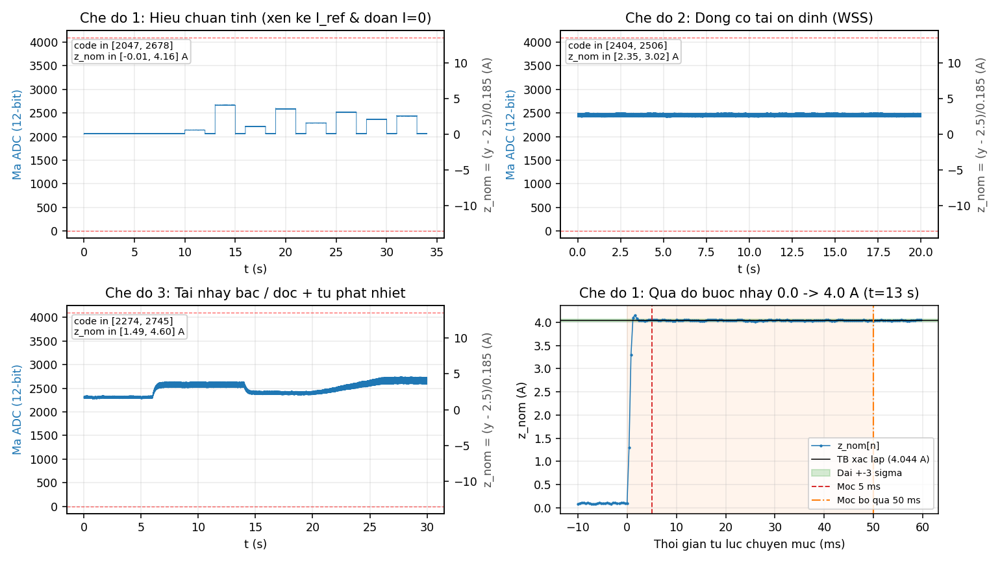
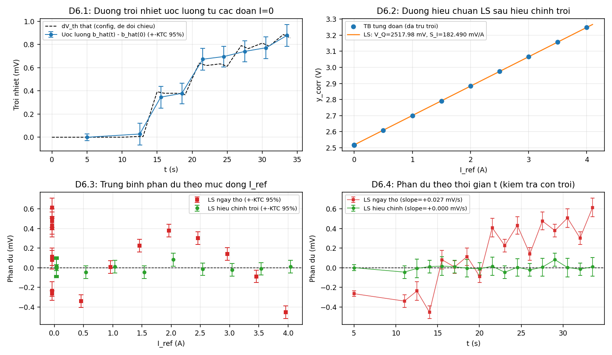
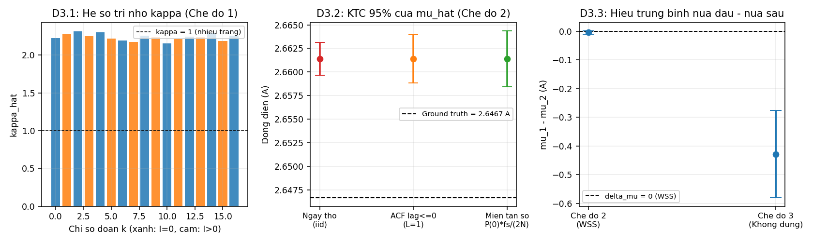
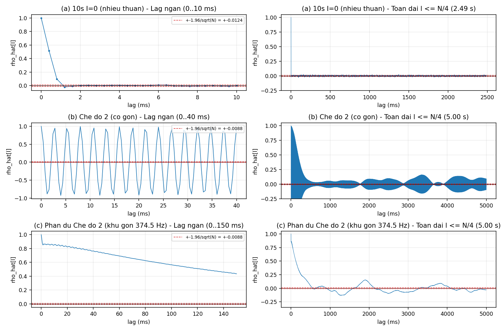
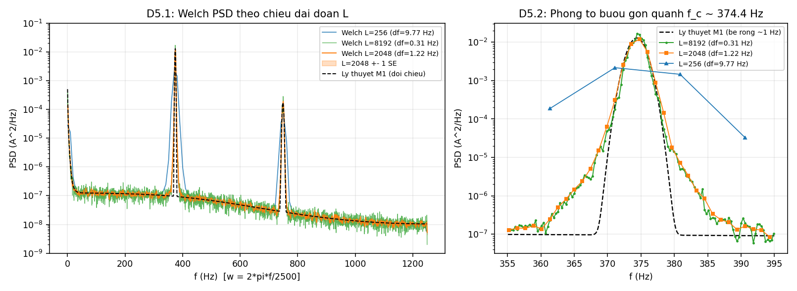

# Tài liệu Phân tích Dữ liệu & Hiệu chuẩn Cảm biến (D1 – D6)

Tài liệu này tổng hợp thiết kế, giải thích chi tiết cách cài đặt dựa trên **yêu cầu đề bài + mã nguồn thực tế** ([config.py](../config.py), [sim_dc_acs712.py](../sim_dc_acs712.py), [m2_analysis_calib.py](../m2_analysis_calib.py)) và kết quả thực nghiệm thu được cho các bước **D1 – D6**.

> [!IMPORTANT]
> **Nguyên tắc xuyên suốt ("Mù tham số thật"):**
> - Mọi con số ước lượng từ một bản ghi (trung bình, phương sai, $\hat{V}_Q, \hat{S}_I$, công suất dải tần, đường trôi nhiệt...) đều đi kèm **sai số chuẩn / KTC 95%** tính trực tiếp từ chính bản ghi đó (có hiệu chỉnh trí nhớ $\hat{\kappa}$).
> - Các tham số "thật" trong [config.py](../config.py) (`S_true`, `dV0`, `kP`, `TC`, `tau_th`...) **không bao giờ dùng trong công thức tính**, chỉ dùng để **chấm điểm / đối chiếu** sau khi đã ước lượng xong.

---

## D1 – Sửa thiết kế Chế độ 1

### 1. Yêu cầu & Ý nghĩa thiết kế
Cập nhật kịch bản Chế độ 1 trong [config.py](../config.py) và hàm `run_mode(1)` trong [sim_dc_acs712.py](../sim_dc_acs712.py) theo dãy đoạn:

```python
# config.py
MODE1 = dict(seq=[(0.0, 10.0)] + [s for I in [0.5, 4.0, 1.0, 3.5, 1.5, 3.0, 2.0, 2.5]
                                   for s in [(I, 2.0), (0.0, 1.0)]])
```

Thiết kế này khắc phục 3 nhược điểm của kịch bản tăng đơn điệu cũ:
1. **Đoạn $I = 0\text{ A}$ dài $10\text{ s}$ đầu tiên ($25\,000$ mẫu):** Chip đang ở trạng thái nguội ($\Delta V_{\text{th}} = 0$), cho bản ghi đủ dài để ước lượng chính xác nhiễu nền thuần túy (dùng cho ACF ở D4a và ước lượng phổ nhiễu ở D7).
2. **Thứ tự dòng xen kẽ lớn–nhỏ `[0.5, 4.0, 1.0, 3.5, 1.5, 3.0, 2.0, 2.5]`:** Phá vỡ tương quan tuyến tính giữa $I_{\text{ref}}$ và lượng trôi nhiệt tích lũy theo thời gian, tránh việc trôi nhiệt làm chệch ước lượng độ nhạy $S_I$.
3. **Đoạn nghỉ $I = 0\text{ A}$ dài $1\text{ s}$ sau mỗi mức dòng:** Tại $I = 0$, thành phần $S_I \cdot I_{\text{ref}} = 0$, nên điện áp đo chỉ còn $V_Q + \Delta V_{\text{th}}(t) + \text{nhiễu}$, tạo ra 9 điểm neo đo trực tiếp đường cong trôi nhiệt $\hat{b}(t)$ (dùng cho D6, D9).

### 2. Cài đặt trong Code
Trong [sim_dc_acs712.py](../sim_dc_acs712.py), nhánh `mode == 1` của `run_mode()` đọc trực tiếp `C.MODE1["seq"]`:
```python
if mode == 1:
    i_a = np.concatenate([np.full(int(T * C.F_SIM), I) for I, T in C.MODE1["seq"]])
    i_avg = i_a.copy()
    t = np.arange(len(i_a)) * dt
    dV_th, dT = thermal_offset(i_a, dt, T0=0.0)
    mot = dict(i_avg=i_avg, i_a=i_a)
```
Tổng thời gian Chế độ 1 là $10 + 8 \times (2 + 1) = 34\text{ s}$, ứng với $N = 85\,000$ mẫu ở $F_S = 2500\text{ Hz}$.

---

## D2 – Sinh dữ liệu và kiểm tra thô

### 1. Yêu cầu & Cách làm trong Code
Hàm `d2_raw_check(data)` trong [m2_analysis_calib.py](../m2_analysis_calib.py):
- Đọc 3 bản ghi `data/mode{1,2,3}.npz` được sinh từ `python sim_dc_acs712.py`.
- Kiểm tra bão hòa ADC 12-bit: xác nhận không có mẫu nào chạm biên `code == 0` hoặc `code == 4095`.
- Kiểm tra quá độ chuyển mức ở Chế độ 1: trên 16 bước nhảy giữa 17 đoạn, đo thời gian để tín hiệu quy đổi nháp $z_{\text{nom}} = (y - 2.5)/0.185$ đi vào dải xác lập $\hat{\mu}_{\text{ss}} \pm \max(3\hat{\sigma}_{\text{ss}}, 0.02|\Delta z|)$.
- Vẽ mã ADC và $z_{\text{nom}}$ cho cả 3 chế độ + phóng to bước nhảy lớn nhất ($0.0 \to 4.0\text{ A}$).

### 2. Kết quả thực tế
| Chế độ | Số mẫu $N$ | Thời lượng | Dải mã ADC (`code`) | Số mẫu bão hòa (`0`/`4095`) | Dòng danh định $z_{\text{nom}}$ |
|---|---:|---:|---:|---:|---|
| **Chế độ 1** | 85 000 | 34.0 s | $[2047, 2678]$ | **0** | $[-0.01, 4.16]\text{ A}$ |
| **Chế độ 2** | 50 000 | 20.0 s | $[2404, 2506]$ | **0** | $\bar{z}_{\text{nom}} = 2.7225 \pm 0.0025\text{ A}$ |
| **Chế độ 3** | 75 000 | 30.0 s | $[2274, 2745]$ | **0** | $[1.49, 4.60]\text{ A}$ |

- **Thời gian xác lập lớn nhất ở Chế độ 1:** **$2.00\text{ ms} < 5.0\text{ ms}$** (ở bước nhảy $0.0 \to 4.0\text{ A}$ tại $t = 13\text{ s}$).
- Do đó, quy tắc **bỏ $50\text{ ms}$ đầu mỗi đoạn (`skip = 125` mẫu)** là hoàn toàn an toàn (hệ số an toàn $> 25$ lần).



---

## D6 – Hiệu chuẩn $V_Q, S_I$ bằng Bình phương tối thiểu (LS)

*(Lưu ý: theo D2, số ampe đúng để dùng cho D3, D4, D5 phải lấy từ D6, nên `d6_calibration()` được chạy ngay sau D2.)*

### 1. Yêu cầu & Cách làm trong Code
Hàm `d6_calibration(data)` dùng hàm `_extract_mode1_segments(d1, skip_s=0.050)` tách 17 đoạn Chế độ 1 (đã bỏ $50\text{ ms}$ đầu):
1. **LS ngây thơ:** Lắp ma trận $H = [\mathbf{1},\, I_{\text{ref}}]$ trên toàn bộ 17 đoạn, giải `U.ls_fit(H_all, y_all)`.
2. **Hiệu chỉnh trôi nhiệt:** Từ 9 đoạn $I_{\text{ref}} = 0$ ($k = 0, 2, \dots, 16$), tính trung bình $\hat{\mu}_{0,j}$ tại tâm thời gian $t_{0,j}$. Nội suy tuyến tính đường trôi tương đối so với mốc nguội ban đầu ($k=0$):
   $$\Delta \hat{b}(t) = \text{interp}(t,\, t_{0,j},\, \hat{\mu}_{0,j}) - \hat{\mu}_{0,0}$$
   Trừ $\Delta\hat{b}(t)$ khỏi $y$ rồi chạy lại LS: $y_{\text{corr}} = y - \Delta\hat{b}(t) = V_Q + S_I I_{\text{ref}}$ (đồng thời kiểm chứng chéo bằng cách thêm $\Delta\hat{b}(t)$ làm cột thứ 3 trong ma trận $H$).
3. **Hiệp phương sai hiệu chỉnh trí nhớ:** Do phần dư trong mỗi đoạn có tự tương quan ($\bar{\kappa} = 2.24$), nhân ma trận hiệp phương sai LS với $\bar{\kappa}$:
   $$\text{Cov}_{\text{eff}} = \bar{\kappa}\cdot \hat{\sigma}^2 (H^T H)^{-1}$$
   Riêng $\hat{V}_Q$ cộng thêm phương sai của mốc gốc $\hat{\mu}_{0,0}$.

### 2. Kết quả & Đối chiếu với `config.py`
Giá trị thật để chấm điểm: $V_{Q,\text{true}} = 2518.00\text{ mV}$, $S_{\text{true}} = 182.500\text{ mV/A}$.

| Phương pháp | $\hat{V}_Q \pm 1.96\,\text{SE}$ (mV) | Chứa $2518.00$? | $\hat{S}_I \pm 1.96\,\text{SE}$ (mV/A) | Chứa $182.500$? | Xu hướng phần dư theo $t$ (mV/s) | Số đoạn phần dư chứa 0 |
|---|---:|:---:|---:|:---:|---:|:---:|
| **LS ngây thơ** | $2518.255 \pm 0.020$ | **Không** | $182.586 \pm 0.012$ | **Không** | $+0.0273 \pm 0.0016$ | $2/17$ |
| **LS hiệu chỉnh trôi** | $2517.985 \pm 0.035$ | **Có** | $182.490 \pm 0.011$ | **Có** | $+0.0004 \pm 0.0016$ | $16/17$ |
| **LS thêm cột $H$** | $2517.981 \pm 0.024$ | **Có** | $182.489 \pm 0.012$ | **Có** | — | — |

**Nhận xét:**
- LS ngây thơ bị trôi nhiệt tích lũy kéo lệch cả $\hat{V}_Q$ và $\hat{S}_I$ ra ngoài KTC 95%, phần dư còn xu hướng tăng rất rõ ($+0.0273\text{ mV/s}$) và chỉ $2/17$ đoạn có phần dư chứa $0$.
- Sau khi khử trôi bằng các đoạn $I=0$ xen kẽ, xu hướng phần dư triệt tiêu về $0$ ($+0.0004 \pm 0.0016\text{ mV/s}$), $16/17$ đoạn có trung bình phần dư chứa $0$ trong KTC 95% ($\approx 94\%$, khớp lý thuyết $95\%$), và KTC 95% chứa trọn cả $V_{Q,\text{true}}$ lẫn $S_{\text{true}}$.



---

## D3 – Thống kê cơ bản kèm KTC & Kiểm tra WSS

### 1. Yêu cầu & Cách làm trong Code
Hàm `d3_basic_stats(data, calib)` quy đổi điện áp sang Ampe bằng $(\hat{V}_Q, \hat{S}_I)$ từ D6:
1. **Chia $N$ vs $N-1$:** Tính cả $\hat{\sigma}_N$ và $\hat{\sigma}_{N-1}$ cho 17 đoạn Chế độ 1 và toàn bộ Chế độ 2.
2. **Hiệu chỉnh trí nhớ theo ACF (`analysis_utils.mean_ci`):** Tính $\hat{\kappa} = 1 + 2\sum_{l=1}^{L}\hat{\rho}[l]$ đến trước lag đầu tiên có $\hat{\rho}[l] \le 0$.
3. **KTC miền tần số cho Chế độ 2:** Tính Welch PSD một phía $P_z(f)$ ($\text{A}^2/\text{Hz}$), lấy $P_z(0)$ từ dải tần thấp sát DC ($0 < f \le 2.5\text{ Hz}$ để tránh méo do trừ trung bình và cửa sổ Hann tại bin $0$), suy ra:
   $$\text{Var}[\hat{\mu}] \approx \frac{S_z(e^{j0})}{N} = \frac{P_z(0)\cdot f_s}{2N}, \qquad \hat{\kappa}_{\text{freq}} = \frac{P_z(0)\cdot f_s}{2\hat{\sigma}_z^2}$$
4. **Kiểm tra WSS (Chế độ 2):** Chia đôi bản ghi ($0\text{--}10\text{ s}$ vs $10\text{--}20\text{ s}$), tính KTC 95% của hiệu hai trung bình $\Delta\hat{\mu} = \hat{\mu}_1 - \hat{\mu}_2$ với phương sai tính theo miền tần số, và đối chứng với Chế độ 3.

### 2. Kết quả & Giải thích
- **Khác biệt $\hat{\sigma}_N$ và $\hat{\sigma}_{N-1}$:** Ở Chế độ 1 ($N = 2375\text{--}24875$), chênh lệch chỉ $0.002\text{ mA}$ ($\le 0.02\%$); ở Chế độ 2 ($N = 50\,000$), $\hat{\sigma}_N = 0.19804\text{ A}$ và $\hat{\sigma}_{N-1} = 0.19804\text{ A}$ (lệch $0.0010\%$, không đáng kể).
- **KTC 95% của $\hat{\mu} = 2.66139\text{ A}$ ở Chế độ 2:**
  1. *Ngây thơ (i.i.d):* $\pm 0.00174\text{ A}$ ($N_{\text{eff}} = 50\,000$).
  2. *ACF dừng ở lag âm đầu tiên ($L=1$):* $\pm 0.00254\text{ A}$ ($\hat{\kappa} = 2.14,\, \hat{N}_{\text{eff}} = 23\,352$). **Cách này sai** vì Chế độ 2 có gợn cổ góp tần số cao ($f_c \approx 374.5\text{ Hz}$, chu kỳ $2.67\text{ ms} \approx 6.7$ mẫu), làm $\hat{\rho}[l]$ đổi dấu âm ngay tại $l = 2$. Thuật toán dừng cộng ngay tại $L=1$ đã bỏ sót toàn bộ phần trí nhớ dương kéo dài của nhiễu tải tần thấp!
  3. *Miền tần số $\frac{P(0)f_s}{2N}$:* $\pm 0.00298\text{ A}$ ($P(0) = 9.23\times 10^{-5}\text{ A}^2/\text{Hz},\, \hat{\kappa}_{\text{freq}} = 2.94,\, \hat{N}_{\text{eff}} = 16\,998$). Phương pháp này đo trực tiếp mật độ phổ tại tần số $0$ nên không bị nhiễu gợn tần cao đánh lừa.
- **Đối chiếu với `x2.mean() = 2.64667 A`:** $\hat{\mu} - \mu_x = +14.7\text{ mA}$ (nằm ngoài KTC vì $\Delta\hat{\mu}$ là sai số ngẫu nhiên $\pm 3\text{ mA}$, còn $14.7\text{ mA}$ là **sai số hệ thống do trôi nhiệt xác lập** $\Delta V_{\text{th}} \approx 2.68\text{ mV}$ ở Chế độ 2 — do Chế độ 2 chạy ở trạng thái đã nóng sẵn, còn $\hat{V}_Q$ hiệu chuẩn ở trạng thái nguội).
- **Kiểm tra WSS:**
  - *Chế độ 2:* $\hat{\mu}_1 = 2.6591\text{ A}, \hat{\mu}_2 = 2.6637\text{ A} \Rightarrow \Delta\hat{\mu} = -0.00466 \pm 0.00603\text{ A}$ (**chứa 0**); $\hat{\sigma}_1^2 = 0.03915,\, \hat{\sigma}_2^2 = 0.03927$ $\rightarrow$ **Thỏa mãn WSS**.
  - *Chế độ 3 (đối chứng):* $\Delta\hat{\mu} = -0.42792 \pm 0.15264\text{ A}$ (**không chứa 0**) $\rightarrow$ **Mất WSS**.



---

## D4 – Ước lượng ACF

### 1. Yêu cầu & Cách làm trong Code
Hàm `d4_acf_analysis(data, calib)` dùng `U.acf_biased(sig, N // 4)` (trừ trung bình, chia $N$) cho 3 chuỗi trên toàn dải $|l| \le N/4$, vẽ kèm dải $\pm 1.96/\sqrt{N}$:
- **(a) $10\text{ s}$ $I=0$ đầu tiên của Chế độ 1** ($N = 24\,875$, bỏ $50\text{ ms}$ đầu).
- **(b) Chế độ 2 trừ trung bình** ($N = 50\,000$).
- **(c) Phần dư Chế độ 2 sau khi khử gợn:** Tự tìm đỉnh phổ $\hat{f}_c = 374.5\text{ Hz}$ từ Welch PSD của $z_2$, lọc chắn dải hai chiều (`signal.iirnotch` + `filtfilt`, $Q=12$) tại $\hat{f}_c$ và $2\hat{f}_c$.

### 2. Kết quả & Giải thích hình dạng
| Tín hiệu | $\hat{\rho}[1..3]$ | Tỷ lệ lag xa ($> N/8$) vượt $\pm\frac{1.96}{\sqrt{N}}$ | Giải thích vật lý |
|---|---:|---:|---|
| **(a) Nhiễu thuần $10\text{ s}$** | $[0.516,\; 0.098,\; -0.021]$ | $9.2\%$ | Tắt rất nhanh sau $2\text{ ms}$ và hơi âm ở lag $2\text{--}3$: dấu hiệu bộ lọc analog bậc $>1$ (Sallen-Key bậc 2 + RC $\Rightarrow$ hệ số $a_2 < 0$). |
| **(b) Chế độ 2 (có gợn)** | $[0.571,\; -0.304,\; -0.882]$ | $87.6\%$ | Dao động cosin chu kỳ $T_c = 1/374.5 \approx 2.67\text{ ms}$ có bao hình tắt dần dạng Gauss (do dao động tốc độ $\omega(t)$ làm pha gợn khuếch tán). |
| **(c) Phần dư khử gợn** | $[0.939,\; 0.881,\; 0.852]$ | $89.9\%$ | Tắt rất chậm theo hàm mũ (còn $\sim 0.43$ ở $150\text{ ms}$), phản ánh cực chậm $e^{-T_s/\tau_{\text{th/load}}} \approx 0.998$ của nhiễu tải Ornstein–Uhlenbeck qua quán tính cơ-điện. |

**Kết luận cho báo cáo:** Không sử dụng các lag xa hơn $N/4$ (và phải thận trọng cả ở lag lớn trong $[0, N/4]$). Hiện tượng $\hat{\rho}[l]$ "lượn sóng" vượt ngưỡng $\pm 1.96/\sqrt{N}$ ở lag $1\text{--}5\text{ s}$ (cột phải hình dưới) **không phải trí nhớ thật** của hệ thống, mà là **sai số ước lượng (variance của $\hat{\rho}[l]$)** khi số cặp mẫu độc lập hiệu dụng giảm mạnh theo công thức Bartlett (đặc biệt khi quá trình có băng hẹp hoặc trí nhớ dài).



---

## D5 – PSD bằng Welch và chọn $L$

### 1. Yêu cầu & Cách làm trong Code
Hàm `d5_welch_psd(data, calib)` thực hiện:
- Tính Welch PSD (cửa sổ Hann, chồng 50%) cho $L \in \{256, 2048, 8192\}$.
- Tự tách $K$ đoạn chồng 50% trong `_welch_with_se()` để tính periodogram từng đoạn $P_k(f)$ và thanh sai số chuẩn $\text{SE}(f) = \text{std}_k(P_k(f)) / \sqrt{K}$ cho $L = 2048$ ($K = 47$ đoạn, sai số chuẩn trung vị $\approx 14.2\%$).
- Tính công suất tích phân trên 5 dải tần và đối chiếu với phổ lý thuyết từ [m1_expected_psd.py](../m1_expected_psd.py).

### 2. Lý do chọn $L$ & Bảng đối chiếu công suất
- **Chọn $L = 8192$ khi đo bướu gợn:** Bướu gợn cổ góp quanh $f_c \approx 374.4\text{ Hz}$ có bề rộng chỉ $\sim 1\text{ Hz}$. Với $L = 256$ ($\Delta f = 9.77\text{ Hz}$) đỉnh bị san phẳng; với $L = 2048$ ($\Delta f = 1.22\text{ Hz}$) độ phân giải vẫn thô hơn bề rộng bướu; chỉ $L = 8192$ ($\Delta f = 0.31\text{ Hz} < 1\text{ Hz}$) mới đo chính xác đỉnh và hình dạng bướu.
- **Chọn $L = 2048$ khi đọc phổ nền:** Cho $K = 47$ đoạn, giảm sai số chuẩn xuống $\sim 14.2\%$ (độ mịn cao, dễ quan sát nền nhiễu Hall/lượng tử).

| Dải tần (Hz) | Lý thuyết M1 ($\text{A}^2$) | Welch $L=8192 \pm \text{SE}$ ($\text{A}^2$) | Sai lệch | Nhận xét |
|---|---:|---:|---:|---|
| `0.5 – 5.0` | $2.885 \times 10^{-4}$ | $(2.238 \pm 0.349) \times 10^{-4}$ | **$-22.4\%$** | Lệch lớn do dải hẹp ($4.5\text{ Hz}$), tín hiệu tải có trí nhớ dài, số đoạn độc lập ở tần thấp ít ($K=11$, SE tới $15.6\%$). |
| `5.0 – 50.0` | $2.575 \times 10^{-5}$ | $(2.502 \pm 0.255) \times 10^{-5}$ | $-2.8\%$ | Khớp trong phạm vi $1\,\text{SE}$. |
| `100.0 – 300.0` | $2.328 \times 10^{-5}$ | $(2.306 \pm 0.051) \times 10^{-5}$ | $-0.9\%$ | Khớp rất sát nền nhiễu Hall qua lọc analog. |
| `360.0 – 390.0` | $3.783 \times 10^{-2}$ | $(3.773 \pm 0.011) \times 10^{-2}$ | $-0.3\%$ | Khớp gần như tuyệt đối năng lượng bướu gợn $f_c$. |
| `900.0 – 1200.0` | $3.811 \times 10^{-6}$ | $(3.832 \pm 0.043) \times 10^{-6}$ | $+0.5\%$ | Khớp chính xác nền nhiễu lượng tử + Hall suy giảm. |



---

## Hướng dẫn chạy lại toàn bộ

```powershell
# 1. Sinh dữ liệu 3 chế độ (tạo data/mode1.npz, mode2.npz, mode3.npz)
python sim_dc_acs712.py

# 2. Chạy toàn bộ phân tích D2 - D6 (in bảng số liệu và lưu 5 hình vào figures/)
python m2_analysis_calib.py
```
