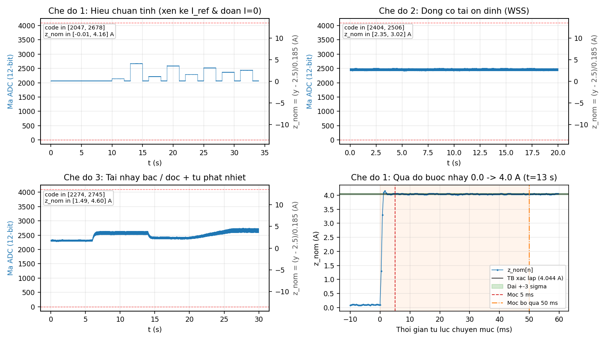
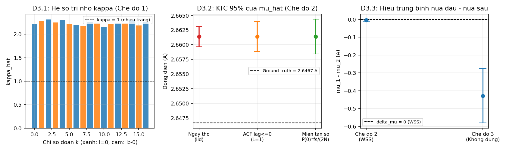
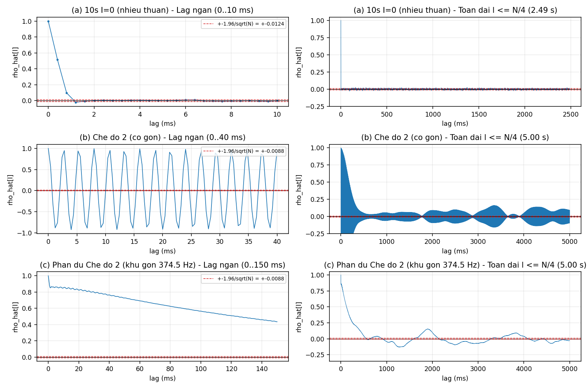
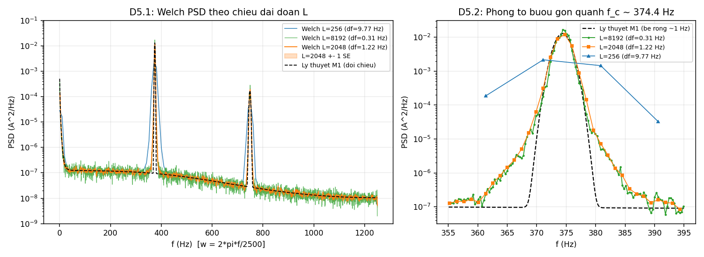
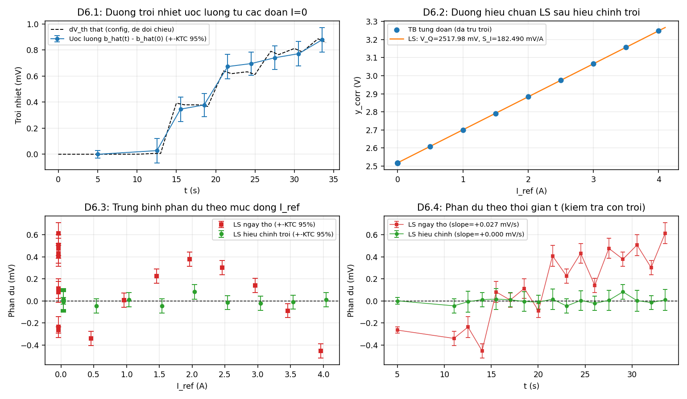
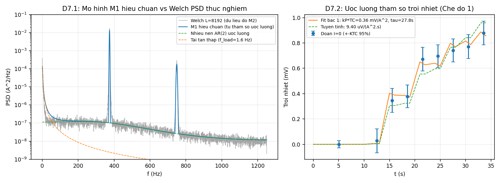

# Báo cáo Phân tích Tín hiệu & Hiệu chuẩn Mô hình Cảm biến (M1 – M2)

**Hệ thống:** Động cơ DC chổi than + Cảm biến dòng Hall ACS712-05B + Mạch lọc tương tự (RC + Sallen-Key bậc 2) + ADC 12-bit ($f_s = 2500\text{ Hz}$).  
**Mã nguồn tái lập toàn bộ số liệu & hình vẽ:** [sim_dc_acs712.py](../sim_dc_acs712.py) (sinh dữ liệu) và [m2_analysis_calib.py](../m2_analysis_calib.py) (phân tích, hiệu chuẩn, xuất hình).

> [!IMPORTANT]
> **Nguyên tắc thực hiện & Phân biệt đại lượng:**
> - **Đại lượng ước lượng** ($\hat{\mu}, \hat{\sigma}^2, \hat{V}_Q, \hat{S}_I, \hat{\rho}[l], \hat{P}_{\text{Welch}}(f), \hat{a}_k, \hat{\tau}_{\text{th}}$) được tính hoàn toàn từ bản ghi đo (`data/mode{1,2,3}.npz`) và luôn đi kèm **sai số chuẩn (SE) / khoảng tin cậy (KTC 95%)** tính từ chính bản ghi đó.
> - **Đại lượng lý thuyết / tham số thật** trong [config.py](../config.py) và [m1_expected_psd.py](../m1_expected_psd.py) ($V_{Q,\text{true}}, S_{\text{true}}, S_{\text{M1}}(f), \tau_{\text{th}}, k_P T_C$) **chỉ dùng để đối chiếu / chấm điểm**, tuyệt đối không đưa vào công thức ước lượng.

---

## 0. Kiểm tra thô dữ liệu & Quá độ chuyển mức

Trước khi phân tích, hàm `d2_raw_check()` kiểm tra tính toàn vẹn của 3 bản ghi:
- **Không bão hòa ADC 12-bit (`0` hoặc `4095`):** Chế độ 1 (`[2047, 2678]`), Chế độ 2 (`[2404, 2506]`), Chế độ 3 (`[2274, 2745]`) đều có `0` mẫu bão hòa.
- **Thời gian xác lập chuyển mức ở Chế độ 1:** Trên 16 bước nhảy dòng, thời gian xác lập tối đa đo được là **$2.00\text{ ms} < 5.0\text{ ms}$** (ở bước nhảy lớn nhất $0.0 \to 4.0\text{ A}$). Do đó, mọi tính toán ở Chế độ 1 đều **bỏ $50\text{ ms}$ đầu mỗi đoạn (`125` mẫu)** để loại bỏ hoàn toàn quá độ mạch lọc tương tự.

---

## 1. Thống kê cơ bản của dữ liệu kèm Sai số / Khoảng tin cậy (KTC)

Hàm `d3_basic_stats()` tính trung bình mẫu $\hat{\mu}$, độ lệch chuẩn chia $N$ ($\hat{\sigma}_N$) và chia $N-1$ ($\hat{\sigma}_{N-1}$), hệ số hiệu chỉnh trí nhớ $\hat{\kappa}$, cỡ mẫu hiệu dụng $\hat{N}_{\text{eff}} = N/\hat{\kappa}$ và KTC 95%.

### 1.1. So sánh ước lượng phương sai chia $N$ và chia $N-1$
- Ở Chế độ 1 ($N = 2375 \dots 24\,875$ mẫu mỗi đoạn sau khi bỏ $50\text{ ms}$), sự khác biệt giữa $\hat{\sigma}_N$ và $\hat{\sigma}_{N-1}$ chỉ khoảng **$0.001\text{--}0.002\text{ mA}$ ($\le 0.02\%$)**.
- Ở Chế độ 2 ($N = 50\,000$ mẫu), $\hat{\sigma}_N = 0.19804\text{ A}$ và $\hat{\sigma}_{N-1} = 0.19804\text{ A}$ (chênh lệch $0.0010\%$), chứng tỏ khi $N$ lớn thì khác biệt giữa ước lượng thiên lệch và không thiên lệch của phương sai là không đáng kể.

### 1.2. Trung bình mẫu & KTC 95% có hiệu chỉnh trí nhớ (Chế độ 1 & Chế độ 2)
- **Trên 17 đoạn Chế độ 1** (quy đổi sang Ampe bằng tham số hiệu chuẩn từ mục 4):
  - Nhiễu nền đo có độ lệch chuẩn ổn định quanh $\hat{\sigma}_v \approx 8.4\text{--}8.6\text{ mA}$.
  - Do mạch lọc tương tự tạo tự tương quan ngắn hạn, hệ số trí nhớ trung bình $\hat{\kappa} \approx 2.24$ (dùng `analysis_utils.mean_ci()` cộng $\hat{\rho}[l]$ đến trước lag đầu tiên $\hat{\rho}[l] \le 0$).
  - KTC ngây thơ (giả sử i.i.d.) bị thu hẹp giả tạo $\sqrt{2.24} \approx 1.50$ lần so với KTC đúng (ví dụ đoạn $I=0$ dài $10\text{ s}$: KTC hiệu chỉnh $\pm 0.16\text{ mA}$ so với ngây thơ $\pm 0.11\text{ mA}$).

- **Trên toàn bộ Chế độ 2 ($N = 50\,000$, $\hat{\mu} = 2.66139\text{ A}$):**

| Phương pháp tính KTC 95% | $\hat{\kappa}$ | $\hat{N}_{\text{eff}}$ | Bán kính KTC 95% ($\text{A}$) | Nhận xét |
|---|---:|---:|---:|---|
| 1. Ngây thơ (giả sử i.i.d.) | $1.00$ | $50\,000$ | $\pm 0.00174$ | Đánh giá thấp sai số vì bỏ qua tương quan. |
| 2. ACF dừng ở lag $\le 0$ ($L=1$) | $2.14$ | $23\,352$ | $\pm 0.00254$ | **Sai phương pháp:** Gợn cổ góp ($f_c \approx 374.5\text{ Hz}$) làm $\hat{\rho}[l]$ đổi dấu âm ngay tại $l=2$, khiến thuật toán dừng sớm và bỏ sót trí nhớ dài của tải. |
| 3. **Miền tần số** $\text{Var}[\hat{\mu}] \approx \frac{P(0)f_s}{2N}$ | **$2.94$** | **$16\,998$** | **$\pm 0.00298$** | **Đúng:** Dùng Welch PSD tại dải thấp $f \approx 0$ ($P(0) = 9.23 \times 10^{-5}\text{ A}^2/\text{Hz}$) nên đo đúng phần phương sai tần số thấp không bị gợn đánh lừa. |

*(Đối chiếu với ground truth $\mu_x = 2.64667\text{ A}$: $\hat{\mu} - \mu_x = +14.7\text{ mA}$, phần chênh này chính là độ trôi nhiệt xác lập $\Delta V_{\text{th}} \approx 2.68\text{ mV}$ ở trạng thái nóng sẵn của Chế độ 2 so với điểm gốc $\hat{V}_Q$ hiệu chuẩn ở trạng thái nguội.)*

### 1.3. Kiểm định tính dừng rộng (WSS) cho Chế độ 2
Chia đôi bản ghi thành nửa đầu ($0\text{--}10\text{ s}$) và nửa sau ($10\text{--}20\text{ s}$), tính KTC 95% của hiệu hai trung bình theo miền tần số:
- **Chế độ 2:** $\hat{\mu}_1 = 2.6591\text{ A},\; \hat{\mu}_2 = 2.6637\text{ A} \Rightarrow \Delta\hat{\mu} = -0.00466 \pm 0.00603\text{ A}$ (**chứa $0$**); phương sai hai nửa là $0.03915$ và $0.03927\text{ A}^2$ $\rightarrow$ **Chế độ 2 thỏa mãn giả thiết WSS**.
- **Chế độ 3 (đối chứng mất WSS):** $\Delta\hat{\mu} = -0.42792 \pm 0.15264\text{ A}$ (không chứa $0$) $\rightarrow$ **Mất WSS rõ rệt**.

---

## 2. Ước lượng Tự tương quan (ACF) và Giải thích hình dạng

Hàm `d4_acf_analysis()` sử dụng ước lượng thiên lệch chia $N$ (`analysis_utils.acf_biased()`) trên dải $|l| \le N/4$ để đảm bảo ma trận tự tương quan luôn xác định dương, kèm dải tham chiếu nhiễu trắng $\pm 1.96/\sqrt{N}$:

1. **(a) Nhiễu thuần $10\text{ s}$ ($I=0$, $N = 24\,875$):**
   - $\hat{\rho}[1..3] = [0.516,\; 0.098,\; -0.021]$, tắt hoàn toàn vào dải $\pm 0.0124$ sau $\sim 2\text{ ms}$.
   - **Giải thích:** Nhiễu trắng Hall qua mạch lọc tương tự RC + Sallen-Key bậc 2 trở thành nhiễu màu có trí nhớ ngắn. Giá trị âm nhẹ ở lag 3 ($-0.021$) là dấu hiệu đáp ứng xung hơi vọt lố của hệ bậc $\ge 2$ (tương ứng hệ số $a_2 < 0$).

2. **(b) Chế độ 2 có gợn cổ góp ($N = 50\,000$):**
   - $\hat{\rho}[1..3] = [0.571,\; -0.304,\; -0.882]$, dao động tuần hoàn chu kỳ $T_c \approx 2.67\text{ ms}$ ($f_c \approx 374.5\text{ Hz}$) với **đường bao tắt dần dạng Gauss**.
   - **Giải thích:** Gợn cổ góp có pha phụ thuộc tích phân tốc độ góc $\omega(t)$. Biến động tải ngẫu nhiên làm pha khuếch tán theo chuyển động Brown, khiến ACF của hàm cosin suy giảm theo dạng Gauss $e^{-\frac{1}{2}\sigma_\phi^2(\tau)}$.

3. **(c) Phần dư Chế độ 2 sau khi khử gợn ($N = 50\,000$):**
   - Lọc chắn dải 2 chiều (`iirnotch` + `filtfilt`, $Q=12$) tại $\hat{f}_c = 374.5\text{ Hz}$ và $2\hat{f}_c = 749.0\text{ Hz}$.
   - $\hat{\rho}[1..3] = [0.939,\; 0.881,\; 0.852]$, tắt **rất chậm** theo hàm mũ (tại $150\text{ ms}$ vẫn còn $\approx 0.43$).
   - **Giải thích:** Phản ánh hằng số thời gian cơ học chậm của động cơ ($\tau_m \approx 237\text{ ms}$, cực rời rạc gần $1$) dưới tác động của nhiễu tải Ornstein–Uhlenbeck.

4. **Lưu ý về lag xa ($l \to N/4$):** Ở cột phải hình dưới, đường ACF của (b) và (c) vẫn "lượn sóng" vượt ngưỡng $\pm 1.96/\sqrt{N}$ tại lag $1\text{--}5\text{ s}$ (tỷ lệ vượt ngưỡng ở nửa sau lần lượt là $87.6\%$ và $89.9\%$). Đây **không phải trí nhớ thật** mà là **phương sai ước lượng** tại lag xa bị khuếch đại khi tín hiệu có băng hẹp / trí nhớ dài; do đó không dùng lag xa hơn $N/4$ để suy diễn mô hình.

---

## 3. Ước lượng PSD bằng Welch, Chọn $L$ và Đối chiếu M1

Hàm `d5_welch_psd()` sử dụng **cửa sổ Hann, chồng lấn $50\%$** với $L \in \{256, 2048, 8192\}$, đồng thời tự tách từng đoạn periodogram trong `_welch_with_se()` để tính thanh sai số chuẩn $\text{SE}(f) = \text{std}_k(P_k(f))/\sqrt{K}$.

### 3.1. Lý do lựa chọn $L$ (Đánh đổi Độ phân giải vs Phương sai)
- **$L = 256$ ($\Delta f = 9.77\text{ Hz}$, $K=389$):** Rất mịn nhưng $\Delta f$ quá thô, làm bẹt đỉnh và phình rộng bướu gợn cổ góp (bề rộng thật chỉ $\sim 1\text{ Hz}$).
- **$L = 2048$ ($\Delta f = 1.22\text{ Hz}$, $K=47$):** Cho sai số chuẩn trung vị $\approx 14.2\%$ $\rightarrow$ **lựa chọn hợp lý để đọc phổ nền** (Hall + lượng tử hóa).
- **$L = 8192$ ($\Delta f = 0.31\text{ Hz}$, $K=11$):** Độ phân giải $0.31\text{ Hz} < 1\text{ Hz}$ $\rightarrow$ **bắt buộc dùng để đo đúng đỉnh và hình dạng bướu gợn $f_c$**, chấp nhận sai số từng bin lớn hơn.

### 3.2. Đối chiếu công suất tích phân theo dải với Lý thuyết M1 ([m1_expected_psd.py](../m1_expected_psd.py))

| Dải tần (Hz) | Lý thuyết M1 ($\text{A}^2$) | Ước lượng Welch $L=8192 \pm \text{SE}$ ($\text{A}^2$) | Sai lệch | Giải thích |
|---|---:|---:|---:|---|
| `0.5 – 5.0` | $2.885 \times 10^{-4}$ | $(2.238 \pm 0.349) \times 10^{-4}$ | **$-22.4\%$** | Dải hẹp ($4.5\text{ Hz}$) ở vùng tần số thấp, tín hiệu tải có trí nhớ dài $\Rightarrow$ số đoạn độc lập ít ($K=11$, SE tới $15.6\%$). |
| `5.0 – 50.0` | $2.575 \times 10^{-5}$ | $(2.502 \pm 0.255) \times 10^{-5}$ | $-2.8\%$ | Khớp trong phạm vi $1\,\text{SE}$. |
| `100.0 – 300.0` | $2.328 \times 10^{-5}$ | $(2.306 \pm 0.051) \times 10^{-5}$ | $-0.9\%$ | Khớp sát nền nhiễu Hall qua lọc analog. |
| `360.0 – 390.0` | $3.783 \times 10^{-2}$ | $(3.773 \pm 0.011) \times 10^{-2}$ | $-0.3\%$ | Khớp gần như tuyệt đối năng lượng bướu gợn $f_c$. |
| `900.0 – 1200.0` | $3.811 \times 10^{-6}$ | $(3.832 \pm 0.043) \times 10^{-6}$ | $+0.5\%$ | Khớp chính xác vùng suy giảm lọc + nhiễu lượng tử. |

---

## 4. Ước lượng Tham số Mô hình Cảm biến (LS & WLS) kèm Sai số

Các hàm `d6_calibration()` và `d7_calibrated_model_check()` ước lượng toàn bộ tham số tĩnh và động học của mô hình chỉ từ dữ liệu đo:

### 4.1. Tham số tĩnh: Bias ($V_Q$) và Gain ($S_I$) bằng LS có hiệu chỉnh trôi nhiệt
- **LS ngây thơ** ($y = V_Q + S_I I_{\text{ref}}$) bị chệch do trôi nhiệt tích lũy: $\hat{V}_{Q,\text{naive}} = 2518.255 \pm 0.020\text{ mV}$, $\hat{S}_{I,\text{naive}} = 182.586 \pm 0.012\text{ mV/A}$ (đều không chứa giá trị thật; phần dư trôi $+0.0273 \pm 0.0016\text{ mV/s}$, chỉ $2/17$ đoạn chứa $0$).
- **LS hiệu chỉnh trôi** (nội suy đường nền $\Delta\hat{b}(t)$ từ 9 đoạn $I=0$ xen kẽ, nhân hiệp phương sai với $\bar{\kappa} = 2.24$):
  $$\hat{V}_Q = 2517.985 \pm 0.035\text{ mV}, \qquad \hat{S}_I = 182.490 \pm 0.011\text{ mV/A}$$
  - **Đối chiếu giá trị thật:** Chứa trọn $V_{Q,\text{true}} = 2518.00\text{ mV}$ và $S_{\text{true}} = 182.500\text{ mV/A}$.
  - **Kiểm tra phần dư:** Độ dốc theo thời gian triệt tiêu về $+0.0004 \pm 0.0016\text{ mV/s}$, và **$16/17$ đoạn ($94.1\%$)** có trung bình phần dư chứa $0$ trong KTC 95%.

### 4.2. Bảng tổng hợp toàn bộ tham số ước lượng của mô hình cảm biến

| Nhóm tham số | Phương pháp ước lượng | Giá trị ước lượng $\pm$ KTC 95% | Giá trị thật (`config.py`, chỉ để chấm) |
|---|---|---|---|
| **Bias nguội $\hat{V}_Q$** | LS hiệu chỉnh trôi + $\bar{\kappa}$ | $2517.985 \pm 0.035\text{ mV}$ | $2518.00\text{ mV}$ |
| **Độ nhạy $\hat{S}_I$** | LS hiệu chỉnh trôi + $\bar{\kappa}$ | $182.490 \pm 0.011\text{ mV/A}$ | $182.500\text{ mV/A}$ |
| **Phương sai nhiễu nền $\hat{\sigma}_v^2$** | Đoạn $10\text{ s}$ ($I=0$), $N_{\text{eff}}$ | $72.01 \pm 1.89\text{ }\mu\text{A}^2$ ($\hat{\sigma}_v = 8.486\text{ mA}$) | — (tổng hợp Hall + ADC + lọc) |
| **Động học nhiễu nền AR(2)** | LS trên $v[n] = a_1 v[n-1] + a_2 v[n-2] + e[n]$ | $\hat{a}_1 = +0.6336 \pm 0.0121$ $\hat{a}_2 = -0.2289 \pm 0.0121$ $\hat{\sigma}_e = 7.078\text{ mA}$ | Hệ lọc RC + Sallen-Key bậc 2 |
| **Trôi nhiệt bậc 1** | WLS phi tuyến trên 9 điểm $I=0$ | $\widehat{k_P T_C} = 0.357 \pm 0.129\text{ mV/A}^2$ $\hat{\tau}_{\text{th}} = 27.8 \pm 13.8\text{ s}$ | $k_P T_C = 0.375\text{ mV/A}^2$ $\tau_{\text{th}} = 30.0\text{ s}$ |
| **Gợn cổ góp (Hài 1 & Hài 2)** | Tích phân quanh đỉnh Welch $L=8192$ | $\hat{f}_c = 374.481 \pm 0.303\text{ Hz}$, $\hat{\sigma}_{f,1} = 1.09\text{ Hz}$ $\hat{P}_1 = 37.725 \pm 0.208\text{ mA}^2$ $2\hat{f}_c = 748.947 \pm 0.605\text{ Hz}$, $\hat{P}_2 = 0.993 \pm 0.008\text{ mA}^2$ | $f_c = 374.4\text{ Hz}$ |
| **Động học dòng tải AR(1)** | LS trên phần dư khử gợn $z_{\text{res}}[n]$ | $\hat{\phi} = 0.9393 \pm 0.0030$ $\hat{\sigma}_x^2 (<30\text{ Hz}) = 3.432 \times 10^{-4}\text{ A}^2$ | Cực cơ-điện + tải OU |

---

## 5. Mô hình Cảm biến đã Hiệu chuẩn & Kiểm định các Giả thiết của M1

Từ hoàn toàn các tham số ước lượng ở Mục 4, mô hình M1 đã hiệu chuẩn trong miền tần số được dựng lại dưới dạng tổng 4 thành phần độc lập:
$$\hat{P}_{\text{M1,calib}}(f) = \underbrace{\frac{\hat{P}_{\text{low}}(0)}{1 + (f/\hat{f}_{\text{load}})^2}}_{\text{Tải tần thấp}} + \underbrace{\sum_{k=1}^{2}\frac{\hat{P}_k}{\sqrt{2\pi}\hat{\sigma}_{f,k}}\exp\!\left(-\frac{(f - k\hat{f}_c)^2}{2\hat{\sigma}_{f,k}^2}\right)}_{\text{Bướu gợn cổ góp Gauss}} + \underbrace{\frac{2\hat{\sigma}_e^2/f_s}{\left|1 - \hat{a}_1 e^{-j2\pi f/f_s} - \hat{a}_2 e^{-j4\pi f/f_s}\right|^2}}_{\text{Nhiễu nền có màu AR(2)}}$$

Như thể hiện trên hình dưới (`D7.1`), phổ của mô hình M1 hiệu chuẩn bám sát phổ Welch thực nghiệm trên toàn dải tần $0\text{--}1250\text{ Hz}$, và đường đáp ứng nhiệt bậc 1 (`D7.2`) đi qua tất cả KTC 95% của 9 điểm đo $I=0$.

### Đánh giá các giả thiết của mô hình M1 trước dữ liệu thực nghiệm

#### A. Các giả thiết ĐƯỢC dữ liệu ủng hộ
1. **Tính tuyến tính của cảm biến ($y = V_Q + S_I i_a$):** Sau khi bù trôi nhiệt, $16/17$ đoạn ở Chế độ 1 có trung bình phần dư chứa $0$ trong KTC 95% và không xuất hiện độ cong phi tuyến theo $I_{\text{ref}}$.
2. **Nhiễu nền có màu bậc $\ge 2$:** ACF tại $I=0$ tắt nhanh sau $2\text{ ms}$ và âm ở lag 3 ($-0.021$); ước lượng AR(2) cho $\hat{a}_2 = -0.2289 \pm 0.0121$ khác $0$ rất có ý nghĩa thống kê, tái tạo chính xác độ dốc suy giảm phổ từ $100\text{ Hz}$ đến $1250\text{ Hz}$ (sai lệch công suất $< 1\%$).
3. **Mô hình bướu gợn dạng Gauss quanh $f_c, 2f_c$:** ACF Chế độ 2 tắt dần theo bao hình Gauss và Welch $L=8192$ cho bướu hình chuông đối xứng với bề rộng $\hat{\sigma}_{f,2} = 2.17\text{ Hz} \approx 2\hat{\sigma}_{f,1} = 2\times 1.09\text{ Hz}$ (đúng với lý thuyết hài bậc 2 khuếch tán pha gấp đôi).
4. **Tính dừng rộng (WSS) ở Chế độ 2:** Kiểm định hiệu trung bình hai nửa ($\Delta\hat{\mu} = -0.00466 \pm 0.00603\text{ A}$) và sự ổn định phương sai ($0.03915$ vs $0.03927\text{ A}^2$) ủng hộ hoàn toàn giả thiết WSS.
5. **Bộ lọc chống chồng phổ triệt nhiễu SMPS:** Không phát hiện đỉnh alias tại tần số gập của $31.4\text{ kHz}$ trên Welch PSD.

#### B. Các giả thiết KHÔNG được ủng hộ / bị vi phạm
1. **Giả thiết điểm không $V_Q$ bất biến (bỏ qua trôi nhiệt):** Bị bác bỏ mạnh. Nếu không bù trôi nhiệt, ước lượng LS cho $V_Q$ và $S_I$ đều sai lệch ra ngoài KTC 95%; ở Chế độ 2 (trạng thái nóng sẵn), giá trị trung bình đo được $\hat{\mu}_2$ cao hơn giá trị thật $\mu_x$ khoảng $+14.7\text{ mA}$ do độ lệch nhiệt xác lập chưa được bù.
2. **Giả thiết nhiễu đo là nhiễu trắng độc lập (i.i.d.):** Bị bác bỏ vì $\hat{\kappa} \approx 2.24$ (Chế độ 1) và $\hat{\kappa}_{\text{freq}} \approx 2.94$ (Chế độ 2); dùng công thức $\sigma/\sqrt{N}$ ngây thơ sẽ đánh giá thấp sai số chuẩn $1.5\text{--}1.7$ lần.
3. **Giả thiết dùng quy tắc dừng ACF tại lag âm đầu tiên cho tín hiệu có thành phần tuần hoàn:** Không áp dụng được ở Chế độ 2 do gợn cổ góp làm $\hat{\rho}[l]$ âm ngay tại $l=2$, buộc phải chuyển sang công thức miền tần số $P(0)f_s/(2N)$.
4. **Khả năng định danh riêng lẻ $\tau_{\text{th}}$ trên bản ghi ngắn $34\text{ s}$:** Do thời lượng có dòng ($24\text{ s}$) nhỏ hơn $\tau_{\text{th}} = 30\text{ s}$, đáp ứng nhiệt gần như tuyến tính theo tích phân $\int i^2 dt$, khiến $\tau_{\text{th}}$ ước lượng có sai số rất rộng ($27.8 \pm 13.8\text{ s}$). Để tách chính xác $\tau_{\text{th}}$ và $k_P T_C$ với sai số hẹp, cần bản ghi hiệu chuẩn kéo dài tối thiểu $2\text{--}3\tau_{\text{th}}$ ($\ge 60\text{--}90\text{ s}$).
