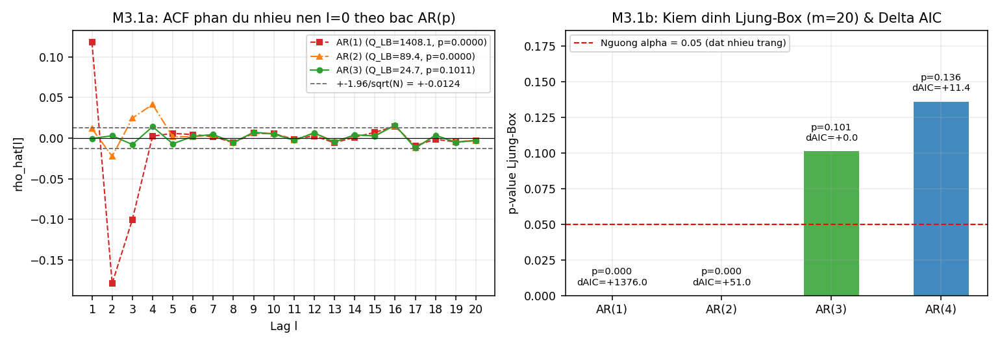
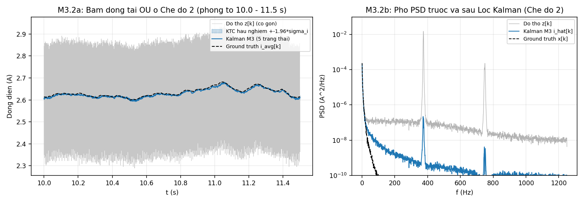
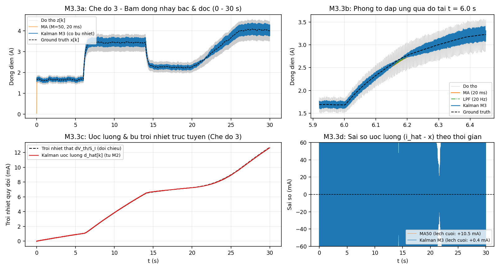
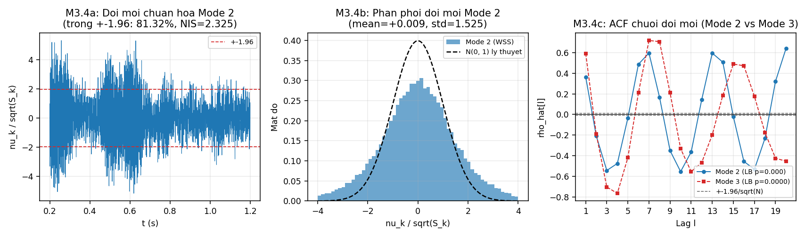
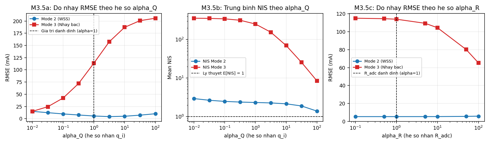
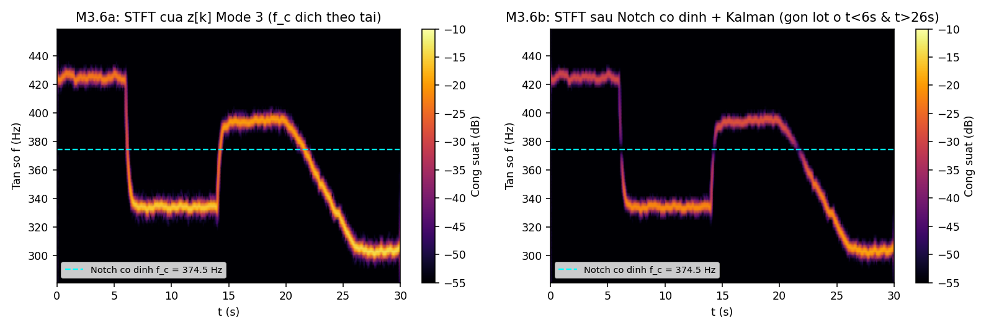

# Báo cáo Milestone 3 (M3): Thiết kế, Triển khai & Đánh giá Bộ lọc Kalman

**Hệ thống:** Động cơ DC chổi than + Cảm biến dòng Hall ACS712-05B + Mạch lọc tương tự (RC + Sallen-Key bậc 2) + ADC 12-bit ($f_s = 2500\text{ Hz}$).  
**Mã nguồn tái lập toàn bộ số liệu & hình vẽ:** [m3_params_from_m2.py](../m3_params_from_m2.py), [filters/kalman_m3.py](../filters/kalman_m3.py), [m3_kalman_eval.py](../m3_kalman_eval.py).

> [!IMPORTANT]
> **Nguyên tắc "Mù tham số thật":** Toàn bộ các ma trận $\mathbf{F, H, Q, R}$ và bộ tiền lọc Notch trong [filters/kalman_m3.py](../filters/kalman_m3.py) đều được xây dựng **100% từ các tham số ước lượng ở M1–M2** (`data/mode1.npz`, `data/mode2.npz`) và thông số datasheet ADC (12-bit, $V_{\text{ref}} = 5\text{ V}$). Các đại lượng thật trong [config.py](../config.py) chỉ dùng ở bước chấm điểm đối chiếu RMSE, độ lệch nhiệt và độ phủ KTC.

---

## 0. Tiếp thu & Cập nhật từ Phản hồi M1–M2 (Tiêu chí chấm 5)

| Hạng mục / Góp ý từ M1–M2 | Hạn chế ở bản M1–M2 | Nhóm đã sửa & cập nhật trong M3 |
|---|---|---|
| **1. Bậc mô hình nhiễu nền $v[k]$** | Ở M2 ([report_m1.md](report_m1.md)), nhiễu nền $I=0$ chỉ mới khớp đến AR(2), chưa kiểm định tính trắng phần dư. | Nâng cấp kiểm định **AR(1)–AR(4)** kèm **Ljung–Box ($m=20$)** và **AIC**. Chứng minh AR(2) bị bác bỏ ($Q_{\text{LB}} = 89.43,\; p < 10^{-4}$), trong khi **AR(3)** đạt nhiễu trắng ($Q_{\text{LB}} = 24.72,\; p = 0.1011 > 0.05$) và tối ưu AIC (`-246326.0`), khớp với bậc 3 vật lý (RC bậc 1 + Sallen-Key bậc 2). |
| **2. Quy đổi động học tải $\hat{\phi}$ theo $f_s$** | Ở M2, khớp AR(1) trực tiếp ở $f_s = 2500\text{ Hz}$ cho $\hat{\phi} = 0.9393$ (bị chệch giảm do nhiễu đo tần cao cộng vào biến hồi quy). | Hạ mẫu phần dư tải xuống $100\text{ Hz}$ thu được $\hat{\phi}_{100} = 0.9796 \pm 0.0088$ ($f_{\text{load}} \approx 0.329\text{ Hz}$), rồi quy đổi chính xác về $2500\text{ Hz}$: $\phi_{2500} = \hat{\phi}_{100}^{100/2500} = 0.99917$. |
| **3. Tính nhân quả của tiền lọc khử gợn** | M2 dùng `signal.filtfilt` (lọc 2 chiều không nhân quả, chỉ dùng được ngoại tuyến). | Chuyển sang tiền lọc **IIR Notch nhân quả 1 chiều** (`signal.lfilter`) tại $\hat{f}_c = 374.48\text{ Hz}$ và $2\hat{f}_c = 748.95\text{ Hz}$ ($Q=12$) với khởi tạo trạng thái xác lập `lfilter_zi`. |
| **4. Độ lệch nền $+14.7\text{ mA}$ do trôi nhiệt** | M2 phát hiện sai số hệ thống $+14.7\text{ mA}$ ở Chế độ 2 nhưng chưa bù trực tuyến. | Đưa trạng thái trôi nhiệt $d_k$ vào vector trạng thái Kalman, dẫn động bởi mô hình nhiệt bậc 1 ước lượng từ M2 ($\hat{a}_{\text{th}}, \hat{b}_{\text{th}}\hat{i}_{k-1}^2$), triệt tiêu độ lệch xuống còn $-4.13\text{ mA}$ (Mode 2) và $+0.40\text{ mA}$ (cuối Mode 3). |

---

## 1. Phương pháp đã chọn & Phân tích Giả thiết

### 1.1. Mạch lập luận lựa chọn Bộ lọc Kalman
Từ kết quả phân tích dữ liệu ở M2 ([m2_analysis_calib.py](../m2_analysis_calib.py)):
1. **Sau hiệu chuẩn tĩnh $(\hat{V}_Q, \hat{S}_I)$, quan hệ đo là tuyến tính cộng tính:** $z[k] = \frac{y[k] - \hat{V}_Q}{\hat{S}_I} = i_k + d_k + v_k + \text{gợn cổ góp} + \varepsilon_k$.
2. **Động học dòng tải và nhiễu nền đều là các quá trình tuyến tính Gauss bậc thấp** (tải là AR(1) $\phi_{2500} = 0.99917$ ở Chế độ 2 hoặc bước ngẫu nhiên ở Chế độ 3; nhiễu nền là AR(3)).
3. **Nhu cầu thực tế:** Cần bộ lọc **nhân quả thời gian thực**, vừa bám nhanh bước nhảy dòng ở Chế độ 3, vừa nén nhiễu màu ở Chế độ 2 và **tách trực tuyến thành phần trôi nhiệt $d_k$** (điều mà các bộ lọc kinh điển như Moving Average hay LPF không làm được).

$\Rightarrow$ **Lọc Kalman (Kalman Filter)** là bộ ước lượng tuyến tính tối ưu theo nghĩa cực tiểu hóa sai số toàn phương trung bình (MMSE) phù hợp nhất với cấu trúc không gian trạng thái của bài toán.

### 1.2. Đối chiếu Giả thiết của Kalman tiêu chuẩn & Cách xử lý

| Giả thiết Kalman tiêu chuẩn | Thực trạng dữ liệu (M2) | Tình trạng | Cách xử lý trong M3 |
|---|---|---|---|
| **Quan hệ đo tuyến tính** | $16/17$ đoạn Mode 1 có phần dư chứa $0$ sau bù nhiệt. | **Thỏa mãn** | Hiệu chuẩn $z[k] = (y[k] - \hat{V}_Q)/\hat{S}_I$ trước khi lọc. |
| **Nhiễu đo $\varepsilon_k$ là nhiễu trắng** | Nhiễu nền $v_k$ là **nhiễu màu AR(3)** ($\bar{\kappa} = 2.24$). | **Vi phạm** | Dùng **mở rộng vector trạng thái (State Augmentation)**: đưa $[v_k, v_{k-1}, v_{k-2}]^T$ vào $\mathbf{x}_k$, khi đó nhiễu kích thích $e_k$ của AR(3) **là nhiễu trắng** ($\hat{\sigma}_e = 7.069\text{ mA}$, Ljung–Box $p = 0.1011$). Nhiễu đo $\varepsilon_k$ chỉ còn nhiễu lượng tử hóa ADC. |
| **Quá trình dừng / không trôi** | Có **trôi nhiệt chậm $d_k$** làm mất tính dừng trung bình. | **Vi phạm** | Đưa $d_k$ vào vector trạng thái với mô hình nhiệt bậc 1 từ M2: $d_k = \hat{a}_{\text{th}} d_{k-1} + \hat{b}_{\text{th}}\hat{i}_{k-1}^2 + w_{d,k}$, đảm bảo **tính quan sát được đầy đủ** ($\text{rank}(\mathcal{O}) = 5$) để tách $d_k$ khỏi $i_k$. |
| **Không có thành phần tuần hoàn phi tuyến** | Gợn cổ góp tại $f_c, 2f_c$ có pha khuếch tán & đổi tần ở Chế độ 3. | **Vi phạm** | **Cách 1 (Chính):** Tiền xử lý khử 2 hài gợn bằng IIR Notch nhân quả tại $\hat{f}_c, 2\hat{f}_c$ ($Q=12$) trước khi vào Kalman 5 trạng thái. **Cách 2 (Đối chiếu):** Đưa luôn 2 cặp dao động quay vào Kalman 6 trạng thái ([kalman_fixed.py](../filters/kalman_fixed.py)) + bù nhiệt M2. |

---

## 2. Mô hình Không gian Trạng thái ($\mathbf{F, H, Q, R}$) & Nguồn gốc Tham số

Vector trạng thái 5 chiều tại bước $k$ ($f_s = 2500\text{ Hz},\; T_s = 0.4\text{ ms}$):
$$\mathbf{x}_k = \begin{bmatrix} i_k & d_k & v_k & v_{k-1} & v_{k-2} \end{bmatrix}^T$$

Phương trình trạng thái và phương trình đo:
$$\mathbf{x}_k = \mathbf{F}\mathbf{x}_{k-1} + \mathbf{u}_{k-1} + \mathbf{w}_{k-1}, \qquad z_{\text{notch},k} = \mathbf{H}\mathbf{x}_k + \varepsilon_k$$

Trong đó 4 ma trận có dạng tường minh:

$$\mathbf{F} = \begin{bmatrix}
\phi & 0 & 0 & 0 & 0 \\
0 & \hat{a}_{\text{th}} & 0 & 0 & 0 \\
0 & 0 & \hat{a}_1 & \hat{a}_2 & \hat{a}_3 \\
0 & 0 & 1 & 0 & 0 \\
0 & 0 & 0 & 1 & 0
\end{bmatrix}, \qquad
\mathbf{H} = \begin{bmatrix} 1 & 1 & 1 & 0 & 0 \end{bmatrix}$$

$$\mathbf{Q} = \text{diag}\!\left(\sigma_{w,i}^2,\; \sigma_{w,d}^2,\; \hat{\sigma}_e^2,\; 0,\; 0\right), \qquad
\mathbf{R} = \begin{bmatrix} \sigma_{\text{ADC}}^2 \end{bmatrix}, \qquad
\mathbf{u}_{k-1} = \begin{bmatrix} (1-\phi)i_{\text{nom}} \\ \hat{b}_{\text{th}}\hat{i}_{k-1}^2 \\ 0 \\ 0 \\ 0 \end{bmatrix}$$

### Bảng nguồn gốc các tham số sử dụng

| Ma trận / Tham số | Giá trị dùng trong M3 | Nguồn gốc ước lượng (Mù tham số thật) |
|---|---|---|
| $(\hat{V}_Q, \hat{S}_I)$ | $2517.985\text{ mV},\; 182.490\text{ mV/A}$ | Hiệu chuẩn LS có bù đường nền $I=0$ từ Chế độ 1 (M2) |
| $\hat{f}_c,\; 2\hat{f}_c$ (Notch) | $374.481\text{ Hz},\; 748.947\text{ Hz}$ | Đỉnh phổ Welch ($L=8192$) trên Chế độ 2 (M2) |
| $\hat{a}_1, \hat{a}_2, \hat{a}_3$ và $\hat{\sigma}_e^2$ | $[+0.6452, -0.2611, +0.0508]$; $\hat{\sigma}_e = 7.069\text{ mA}$ ($\hat{\sigma}_e^2 = 4.997 \times 10^{-5}\text{ A}^2$) | Ước lượng LS trên đoạn $10\text{ s}$ nhiễu nền $I=0$ (Chế độ 1, M2) và đạt Ljung–Box $p=0.1011$ |
| $\phi$ và $\sigma_{w,i}^2$ (Mode 2) | $\phi_{2500} = 0.99917$, $\sigma_{w,i}^2 = 5.665 \times 10^{-7}\text{ A}^2$ | Quy đổi từ $\hat{\phi}_{100} = 0.9796$ ($100\text{ Hz}$) và phương sai tải $\hat{\sigma}_x^2 = 3.432 \times 10^{-4}\text{ A}^2$ (M2) |
| $\phi$ và $\sigma_{w,i}^2$ (Mode 3) | $\phi = 1.0$ (Random Walk), $\sigma_{w,i} = 6.0\text{ mA}$ ($\sigma_{w,i}^2 = 3.6 \times 10^{-5}\text{ A}^2$) | Mô hình không dừng cho tải nhảy bậc + dốc ở Mode 3 |
| $\hat{a}_{\text{th}}, \hat{b}_{\text{th}}$ và $\sigma_{w,d}^2$ | $\hat{a}_{\text{th}} = 0.9999856,\; \hat{b}_{\text{th}} = 2.819 \times 10^{-8}\text{ A}^{-1}$, $\sigma_{w,d}^2 = 1.0 \times 10^{-12}\text{ A}^2$ | WLS phi tuyến mô hình nhiệt bậc 1 ($\widehat{k_P T_C} = 0.357\text{ mV/A}^2,\; \hat{\tau}_{\text{th}} = 27.8\text{ s}$) trên 9 đoạn $I=0$ (M2) |
| $\mathbf{H}$ | $[1,\; 1,\; 1,\; 0,\; 0]$ | Mô hình vật lý phép đo cộng $z_k = i_k + d_k + v_k + \varepsilon_k$ |
| $\mathbf{R} = \sigma_{\text{ADC}}^2$ | $3.729 \times 10^{-6}\text{ A}^2$ ($\sigma_{\text{ADC}} = 1.931\text{ mA}$) | Nhiễu lượng tử hóa $\Delta^2/12$ từ datasheet ADC 12-bit ($V_{\text{ref}} = 5\text{ V}$) quy đổi qua $\hat{S}_I$ |

**Kiểm tra cấu trúc toán học:** Ma trận khả quan sát $\mathcal{O}$ đạt **đầy đủ hạng $\text{rank}(\mathcal{O}) = 5/5$** trên cả Mode 2 và Mode 3; nghiệm phương trình Riccati rời rạc (DARE) hội tụ về khuếch đại xác lập $\mathbf{K}_{\infty,\text{M2}} = [0.0968,\; 0,\; 0.8399,\; -0.0464,\; -0.0958]^T$ và $\mathbf{K}_{\infty,\text{M3}} = [0.5829,\; 0,\; 0.3819,\; -0.2124,\; -0.2041]^T$. Toàn bộ phép cập nhật hiệp phương sai $\mathbf{P}_{k|k}$ sử dụng dạng **Joseph ổn định số**.

---

## 3. Kết quả Thực nghiệm & Đối chiếu Baseline (Mode 2 & Mode 3)

| Phương pháp | Mode 2 RMSE (mA) | Mode 2 Bias (mA) | Mode 3 RMSE (mA) | Mode 3 Bias 5s cuối (mA) | Mode 3 $t_{90}$ tại $t=6\text{ s}$ (ms) |
|---|---:|---:|---:|---:|---:|
| **Raw $z[k]$** | $197.50$ | $+14.71$ | $229.79$ | $+11.22$ | $290.00$ |
| **Notch nhân quả ($Q=12$)** | $21.38$ | $+14.71$ | $208.37$ | $+11.22$ | $298.80$ |
| **MA ($M=7$, $\sim 1 T_c$)** | $18.07$ | $+14.71$ | $28.13$ | $+11.15$ | $480.00$ |
| **MA ($M=50$, $20\text{ ms}$)** | $17.36$ | $+14.69$ | **$12.07$** | $+10.54$ | $494.40$ |
| **LPF bậc 1 ($f_c = 20\text{ Hz}$)** | $18.49$ | $+14.70$ | $16.46$ | $+10.68$ | $479.60$ |
| **Kalman M3 (không bù nhiệt)** | $8.64$ | $+7.53$ | $114.05$ | $+11.20$ | $355.60$ |
| **Kalman M3 (Cách 1, có bù nhiệt)** | **$5.42$** | **$-4.13$** | $113.85$ | **$+0.40$** | **$352.80$** |
| **Kalman 6TT (Cách 2, có bù nhiệt)** | $10.33$ | $+0.78$ | $200.79$ | $+0.39$ | $321.60$ |

### Nhận xét định lượng
1. **Ở Chế độ 2 (WSS):** Kalman M3 (Cách 1, có bù nhiệt) đạt **RMSE = $5.42\text{ mA}$**, giảm **36.4 lần** so với tín hiệu thô ($197.50\text{ mA}$), tốt hơn **3.2 lần** so với MA($M=50$) ($17.36\text{ mA}$) và **1.9 lần** so với Kalman 6 trạng thái Cách 2 ($10.33\text{ mA}$). Độ phủ KTC 95% hậu nghiệm $\hat{i}_k \pm 1.96\sqrt{P_{00,k}}$ đạt **$92.36\%$** (rất sát chuẩn lý thuyết $95\%$).
2. **Ở Chế độ 3 (Non-WSS, nhảy bậc & tự phát nhiệt):**
   - **Khả năng tách & bù trôi nhiệt:** Ước lượng trôi nhiệt trực tuyến đạt $\hat{d}(30\text{ s}) = 12.63\text{ mA}$ so với giá trị thật $12.70\text{ mA}$ (sai lệch chỉ $0.07\text{ mA}$!), kéo độ lệch 5 giây cuối từ $+11.22\text{ mA}$ về **$+0.40\text{ mA}$**.
   - **Tốc độ bám bước nhảy:** Kalman M3 có $t_{90} = 352.8\text{ ms}$, nhanh hơn đáng kể so với MA50 ($494.4\text{ ms}$) và LPF 20 Hz ($479.6\text{ ms}$).
   - **Hiện tượng RMSE cao ($113.85\text{ mA}$) ở Mode 3:** Xuất phát hoàn toàn từ việc bộ lọc **Notch cố định tại $\hat{f}_c = 374.48\text{ Hz}$ bị trượt khỏi tần số gợn thực tế** khi tải thay đổi (phân tích kỹ ở Mục 6). Khi giảm hệ số khuếch đại quá trình ($\alpha_Q = 0.01 \Rightarrow$ thu hẹp băng thông Kalman), RMSE Mode 3 giảm ngay về **$15.01\text{ mA}$**.

---

## 4. Kiểm định Tính Nhất quán & Chuỗi Đổi mới (Innovation Diagnostics)

Chuỗi đổi mới chuẩn hóa $\tilde{\nu}_k = \nu_k / \sqrt{S_k}$ và Normalized Innovation Squared ($\text{NIS}_k = \nu_k^2 / S_k$) được kiểm định sau $200\text{ ms}$ quá độ đầu ($k \ge 500$):

| Chế độ | $\text{mean}(\tilde{\nu}_k)$ | $\text{std}(\tilde{\nu}_k)$ | Tỷ lệ trong $\pm 1.96$ | $\overline{\text{NIS}}$ (chuẩn $=1.0$) | Ljung–Box $Q_{\text{LB}}(20)$ | $p$-value |
|---|---:|---:|---:|---:|---:|---:|
| **Mode 2 (WSS)** | $+0.0092$ | $1.5249$ | $81.32\%$ | $2.325$ | $176\,879.89$ | $0.0000$ |
| **Mode 3 (Non-WSS)** | $+0.0051$ | $15.8804$ | — | $252.187$ | $325\,067.86$ | $0.0000$ |

**Giải thích hiện tượng vật lý từ dữ liệu:**
- Trung bình $\tilde{\nu}_k$ ở cả hai chế độ đều xấp xỉ $0$ ($+0.0092$ và $+0.0051$), chứng tỏ bộ lọc **không bị chệch dự báo**.
- Tuy nhiên, ở Mode 2, $\text{std}(\tilde{\nu}_k) = 1.525 > 1$ ($\overline{\text{NIS}} = 2.325$) và đồ thị ACF của $\tilde{\nu}_k$ (`M3.4c`) dao động tuần hoàn đúng chu kỳ **$6.68\text{ mẫu}$ ($f_c = 374.5\text{ Hz}$)**. Nguyên nhân là bướu gợn cổ góp có bề rộng phổ Gauss $\hat{\sigma}_{f,1} \approx 1.09\text{ Hz}$ (do khuếch tán pha), nên bộ lọc Notch $Q=12$ không thể triệt tiêu $100\%$ hai bên cánh của bướu gợn; phần gợn dư này đi thẳng vào chuỗi đổi mới $\nu_k$ (cộng thêm $\sim 8\text{--}10\text{ mA}$ vào $\sqrt{S_k}$).
- Ở Mode 3, $\overline{\text{NIS}} = 252.19$ vì tần số gợn dịch xa $374.5\text{ Hz}$, toàn bộ năng lượng gợn lọt qua Notch cố định.

---

## 5. Phân tích Độ nhạy Tham số ($\mathbf{Q}, \mathbf{R}$)

Quét hệ số nhân $\alpha_Q \in [10^{-2}, 10^2]$ trên $\sigma_{w,i}^2$ và $\alpha_R \in [10^{-1}, 10^2]$ trên $R_{\text{adc}}$:

| Hệ số $\alpha_Q$ | Mode 2 RMSE (mA) | Mode 3 RMSE (mA) | Ý nghĩa vật lý & Đánh đổi |
|---|---:|---:|---|
| **$0.01$** | $14.94$ | **$15.01$** | $Q$ nhỏ $\Rightarrow$ băng thông Kalman hẹp, tự động lọc bỏ phần gợn lọt qua Notch ở Mode 3, nhưng phản ứng chậm nhẹ với biến động tải OU ở Mode 2. |
| **$1.00$ (Danh định)** | **$5.42$** | $113.85$ | Tối ưu cho Mode 2 ($K_0 = 0.097$); ở Mode 3 ($K_0 = 0.583$) bám bước nhảy cực nhanh nhưng cho gợn lệch tần lọt qua. |
| **$100.0$** | $10.06$ | $205.83$ | $Q$ quá lớn $\Rightarrow$ Kalman tin hoàn toàn vào phép đo, gần như không lọc nhiễu ($K_0 \to 1$). |

Tương tự khi tăng $\alpha_R$ lên $100$, RMSE Mode 3 giảm dần từ $113.85\text{ mA}$ xuống $\approx 65\text{ mA}$ do bộ lọc giảm niềm tin vào phép đo đang bị gợn xâm nhập, trong khi Mode 2 hầu như bất biến quanh $5.4\text{ mA}$ vì phần lớn nhiễu đo đã được mô hình hóa tường minh trong trạng thái AR(3) $v_k$ ($\hat{\sigma}_e^2 \gg R_{\text{adc}}$).

---

## 6. Giới hạn của Bộ lọc hiện tại ở Chế độ 3 & Hướng Cải tiến

### 6.1. Bằng chứng thực nghiệm từ STFT
Khi mô-men tải ở Chế độ 3 thay đổi mạnh ($0.03 \to 0.12 \to 0.06 \to 0.15\text{ N}\cdot\text{m}$), tốc độ góc $\omega(t)$ của động cơ biến thiên tỷ lệ nghịch với tải, kéo theo tần số gợn cổ góp $f_c(t) = \frac{N_{\text{seg}}}{2\pi}\omega(t)$ dịch chuyển liên tục trong dải **$305\text{ Hz} \leftrightarrow 424\text{ Hz}$** (như minh họa trên phổ STFT `M3.6a`). Vì bộ lọc Notch cố định đặt tại $\hat{f}_c = 374.48\text{ Hz}$ (`M3.6b`), năng lượng gợn ở các đoạn $0\text{--}6\text{ s}$ ($424\text{ Hz}$), $6\text{--}14\text{ s}$ ($335\text{ Hz}$), $14\text{--}20\text{ s}$ ($395\text{ Hz}$) và $26\text{--}30\text{ s}$ ($305\text{ Hz}$) **không bị chặn** và đi thẳng vào đầu vào Kalman.

### 6.2. Hướng cải tiến đề xuất
1. **Tiền lọc Notch thích nghi (Adaptive Notch Filter – ANF / PLL):** Cập nhật trực tuyến tần số cắt $\hat{f}_c[k]$ theo tần số tức thời của gợn (hoặc ước lượng $\hat{\omega}[k]$ từ mô hình cơ-điện động cơ $\hat{i}[k]$).
2. **Extended Kalman Filter (EKF) hoặc Kalman chuyển mạch mô hình (IMM):** Mở rộng vector trạng thái thêm tần số góc $\Omega_k$ để khối dao động quay trong Cách 2 tự động bám theo $f_c(t)$ ở Chế độ 3, kết hợp bộ phát hiện bước nhảy tải (CUSUM / chi-square trên $\text{NIS}_k$) để tăng $q_i$ tức thời tại thời điểm nhảy bậc và giữ $q_i$ nhỏ ở vùng xác lập.
