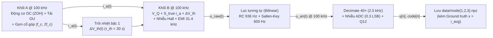
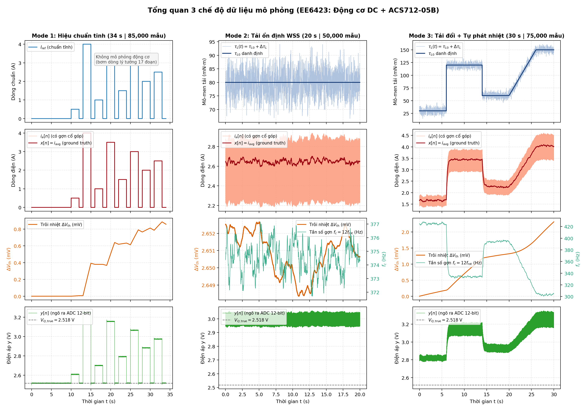
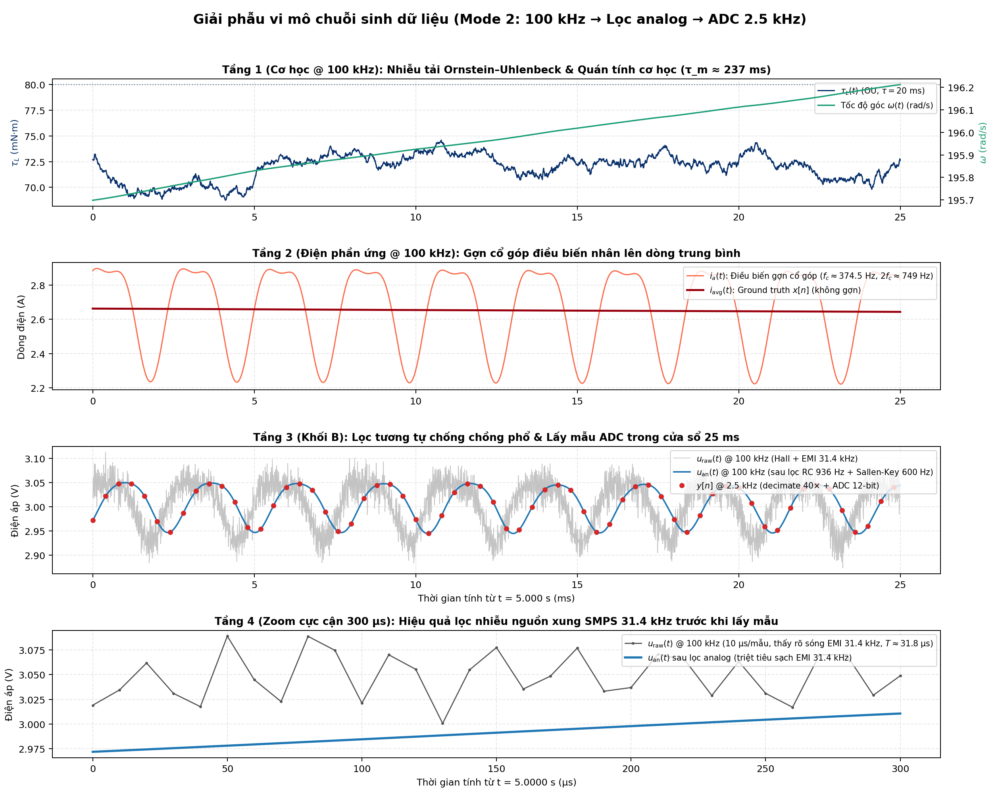
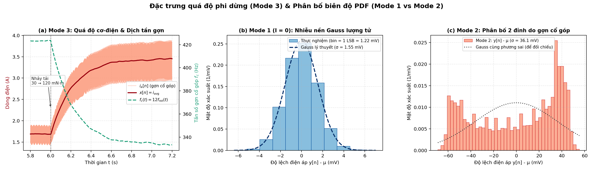

# Mô phỏng, Thống kê & Trực quan hóa Dữ liệu (EE6423)

Tài liệu này trình bày chi tiết toàn bộ quy trình sinh dữ liệu mô phỏng trong [sim_dc_acs712.py](../sim_dc_acs712.py) (với các tham số tập trung tại [config.py](../config.py)), bảng thống kê chi tiết số mẫu và đặc trưng của 3 chế độ dữ liệu trong `data/mode{1,2,3}.npz`, cùng phương pháp trực quan hóa (visualization) đa thang đo để kiểm chứng tính đúng đắn vật lý – thống kê trước khi bước vào các giai đoạn phân tích M1–M3.

---

## 1. Cơ chế sinh dữ liệu vật lý – thống kê

### 1.1. Kiến trúc đa tốc độ & Tính tái lập

Trong thực tế, tín hiệu đo từ cảm biến Hall ACS712-05B chịu tác động đồng thời của động lực học cơ-điện chậm ($\sim 237\text{ ms}$), gợn cổ góp trung tần ($\sim 300\text{--}850\text{ Hz}$), và nhiễu nguồn xung cao tần ($31.4\text{ kHz}$). Do đó, bộ sinh dữ liệu áp dụng kiến trúc **mô phỏng đa tốc độ (multi-rate)**:



- **Lưới mô phỏng "liên tục":** $F_{\text{sim}} = 100\,000\text{ Hz}$ ($\Delta t = 10\text{ µs}$), đủ mịn so với tần số nhiễu nguồn xung SMPS ($31.4\text{ kHz}$, xấp xỉ $3.18$ mẫu/chu kỳ) và hằng số thời gian điện phần ứng ($\tau_e = 2.08\text{ ms}$).
- **Lưới lấy mẫu ADC:** $F_s = 2500\text{ Hz}$ ($T_s = 0.4\text{ ms}$), tương ứng hệ số decimate $\text{DECIM} = F_{\text{sim}} / F_s = 40$.
- **Tái lập 100%:** Sử dụng `np.random.default_rng(SEED + 1000 * mode)` với `SEED = 20252646`, đảm bảo mỗi chế độ có luồng ngẫu nhiên độc lập nhưng tái lập chính xác từng bit.

---

### 1.2. Khối A – Động cơ DC chổi than & Tải ngẫu nhiên (`simulate_motor`)

#### (a) Hệ phương trình trạng thái cơ – điện
Động cơ DC kích từ độc lập/nam châm vĩnh cửu được mô tả bằng hệ tuyến tính 2 trạng thái $\mathbf{s}(t) = [\,i_{\text{avg}}(t),\; \omega(t)\,]^T$ với ngõ vào $\mathbf{u}(t) = [\,U_s,\; \tau_L(t)\,]^T$:

$$
\begin{cases}
L_a \dfrac{di_{\text{avg}}}{dt} + R_a i_{\text{avg}} + K_e \omega = U_s \\[6pt]
J \dfrac{d\omega}{dt} + B \omega = K_t i_{\text{avg}} - \tau_L(t)
\end{cases}
\Longleftrightarrow
\dot{\mathbf{s}} = \mathbf{A}\mathbf{s} + \mathbf{B}\mathbf{u}
$$

Với các tham số trong [config.py](../config.py) ($U_s = 12\text{ V}$, $R_a = 1.2\ \Omega$, $L_a = 2.5\text{ mH}$, $K_e = K_t = 0.045$, $J = 4\times 10^{-4}\text{ kg}\cdot\text{m}^2$, $B = 2\times 10^{-4}\text{ N}\cdot\text{m}\cdot\text{s/rad}$):
- Hằng số thời gian điện: $\tau_e = L_a / R_a \approx 2.08\text{ ms}$.
- Hằng số thời gian cơ học: $\tau_m = J R_a / (K_e K_t) \approx 237\text{ ms}$.

Để giải chính xác và nhanh trên hàng triệu mẫu ($100\text{ kHz}$), hệ được **rời rạc hóa Zero-Order Hold (ZOH) chính xác** bằng ma trận mũ:

$$
\exp\!\left(\begin{bmatrix}\mathbf{A} & \mathbf{B} \\ \mathbf{0} & \mathbf{0}\end{bmatrix}\Delta t\right) = \begin{bmatrix}\mathbf{A}_d & \mathbf{B}_d \\ \mathbf{0} & \mathbf{I}\end{bmatrix}
$$

Sau đó hàm `_fast_lsim()` đặt độ lệch quanh điểm xác lập ban đầu $\mathbf{s}_0 = -\mathbf{A}^{-1}\mathbf{B}\mathbf{u}[0]$ và tách thành các hàm truyền SISO (`signal.ss2tf`) chạy qua `signal.lfilter` bằng C (nhanh hơn nhiều lần so với vòng lặp Python nhưng tương đương chính xác `dlsim` và có hàm `rk4_reference()` để đối chiếu).

#### (b) Nhiễu tải ngẫu nhiên Ornstein–Uhlenbeck (OU)
Mô-men tải tổng $\tau_L(t) = \tau_{L0}(t) + \Delta\tau_L(t)$, trong đó $\Delta\tau_L(t)$ là quá trình OU liên tục ($\sigma = 0.004\text{ N}\cdot\text{m}$, $\tau = 20\text{ ms}$), được rời rạc hóa **chính xác** thành quá trình AR(1):

$$
\Delta\tau_L[k] = a\,\Delta\tau_L[k-1] + \sigma\sqrt{1 - a^2}\,e[k], \qquad a = e^{-\Delta t / \tau},\quad e[k] \sim \mathcal{N}(0, 1)
$$

#### (c) Gợn cổ góp điều biến nhân (Commutator ripple)
Với $N_{\text{seg}} = 12$ phiến cổ góp, góc pha chuyển mạch tích phân trực tiếp từ tốc độ góc tức thời $\theta_c(t) = N_{\text{seg}} \int_0^t \omega(\xi)\,d\xi$. Dòng phần ứng tức thời được điều biến nhân bởi hài bậc 1 ($\gamma_1 = 0.12$) và bậc 2 ($\gamma_2 = 0.04$):

$$
i_a(t) = i_{\text{avg}}(t)\Big[1 + \gamma_1 \cos(\theta_c(t) + \phi_1) + \gamma_2 \cos(2\theta_c(t) + \phi_2)\Big]
$$

với $\phi_1, \phi_2 \sim \mathcal{U}(0, 2\pi)$. Vì $\omega(t)$ biến động ngẫu nhiên theo tải OU nên pha $\theta_c(t)$ bị khuếch tán kiểu chuyển động Brown; hệ quả là phổ PSD của gợn cổ góp là **bướu hình chuông Gauss** chứ không phải vạch phổ Dirac.

> [!IMPORTANT]
> **Định nghĩa Ground Truth:** Đại lượng cần ước lượng ở toàn bộ dự án là **`x[n] = i_avg(n T_s)`** — dòng điện trung bình **không bao gồm** gợn cổ góp và chưa qua lọc analog.

---

### 1.3. Khối B – Cảm biến ACS712-05B, Trôi nhiệt, Lọc tương tự & ADC (`sensor_chain`)

1. **Trôi nhiệt tự phát nhiệt (`thermal_offset`):**
   Công suất tỏa nhiệt trên đường dẫn dòng tỷ lệ với $i_a^2(t)$, đi qua quán tính nhiệt bậc 1 ($\tau_{\text{th}} = 30\text{ s}$, $k_P = 1.5\ ^\circ\text{C/A}^2$, $T_C = 0.25\text{ mV/}^\circ\text{C}$):
   $$
   \Delta T[k] = a_{\text{th}} \Delta T[k-1] + (1 - a_{\text{th}})\,k_P\,i_a^2[k], \qquad \Delta V_{\text{th}}[k] = T_C\,\Delta T[k], \qquad a_{\text{th}} = e^{-\Delta t / \tau_{\text{th}}}
   $$
   - **Mode 1 & Mode 3:** Khởi đầu nguội ($T_0 = 0$).
   - **Mode 2:** Khởi tạo **nóng sẵn** ở trạng thái xác lập $T_0 = k_P i_{\text{ss}}^2 \big(1 + \frac{\gamma_1^2 + \gamma_2^2}{2}\big)$ để bản ghi thỏa mãn tính dừng rộng (WSS).

2. **Nhiễu trắng Hall chuẩn hóa theo datasheet:**
   Datasheet ACS712-05B cho nhiễu $\sigma_{\text{hall,2k}} = 3.5\text{ mV}_{\text{rms}}$ đo với tụ $C_F = 47\text{ nF}$ ($R_F = 1.7\text{ k}\Omega \Rightarrow f_{c,\text{ds}} = \frac{1}{2\pi R_F C_F} \approx 1992\text{ Hz}$). Do băng thông nhiễu tương đương của mạch RC bậc 1 là $\frac{\pi}{2} f_{c,\text{ds}}$, mật độ phổ công suất một phía và độ lệch chuẩn mẫu trắng tại $F_{\text{sim}}$ là:
   $$
   N_0 = \frac{\sigma_{\text{hall,2k}}^2}{\frac{\pi}{2} f_{c,\text{ds}}} \approx 3.91 \times 10^{-9}\ \text{V}^2/\text{Hz}, \qquad \sigma_{n,\text{sim}} = \sqrt{N_0 \frac{F_{\text{sim}}}{2}} \approx 14.0\text{ mV}
   $$

3. **Nhiễu nguồn xung EMI (SMPS) & Tín hiệu thô `u_raw`:**
   $$
   u_{\text{raw}}(t) = \underbrace{0.5\,V_{CC} + \Delta V_0}_{V_{Q,\text{true}} = 2.518\text{ V}} + \Delta V_{\text{th}}(t) + S_{\text{true}}\,i_a(t) + n_{\text{hall}}(t) + A\cos(2\pi f_{\text{smps}} t + \phi_{\text{emi}})
   $$
   với $S_{\text{true}} = 0.1825\text{ V/A}$, $A = 25\text{ mV}$, $f_{\text{smps}} = 31.4\text{ kHz}$.

4. **Mạch lọc tương tự chống chồng phổ (`analog_filters`):**
   Chuyển đổi bằng biến đổi song tuyến (`signal.bilinear`) ở $F_{\text{sim}} = 100\text{ kHz}$:
   - Tầng 1 – Lọc RC nội bộ chân FILTER: $R_F = 1.7\text{ k}\Omega$, $C_F = 100\text{ nF} \Rightarrow f_{c1} \approx 936.2\text{ Hz}$.
   - Tầng 2 – Sallen-Key Butterworth bậc 2: $f_{\text{sk}} = 600\text{ Hz}$, $Q = 0.7071$ (bật mặc định với `use_sallen_key=True`).
   - Kỹ thuật chống quá độ DC tại $t = 0$: code thực hiện `lfilter(b, a, u - u[0]) + u[0]` để trạng thái ban đầu của bộ lọc cân bằng ngay tại mức điện áp tĩnh ban đầu.

5. **Lấy mẫu & Lượng tử hóa ADC 12-bit:**
   - Decimate 40 lần: `u_s = u_an[::40]` ($F_s = 2500\text{ Hz}$).
   - Cộng nhiễu nội ADC: $\sigma_{\text{adc}} = 0.3\text{ LSB}$, với $\text{LSB} = V_{\text{ref}} / 2^{12} = 5.0 / 4096 \approx 1.2207\text{ mV}$.
   - Lượng tử hóa & cắt bão hòa: $\text{code}[n] = \text{clip}(\text{round}(u_s / \text{LSB}),\, 0,\, 4095)$ và $y[n] = \text{code}[n] \cdot \text{LSB}$.

---

## 2. Thống kê số mẫu & Đặc trưng từng Mode

### 2.1. Quy mô dữ liệu tổng hợp

| Chế độ | File dữ liệu | Dung lượng | Seed | Thời lượng $T$ | Số mẫu mô phỏng ($100\text{ kHz}$) | Số mẫu lưu trữ ($2500\text{ Hz}$) | Trạng thái nhiệt ban đầu |
| :---: | :--- | :---: | :---: | :---: | :---: | :---: | :---: |
| **Mode 1** | `data/mode1.npz` | `705 KB` | `20253646` | `34.0 s` | `3,400,000` | **`85,000`** | Nguội ($T_0 = 0$) |
| **Mode 2** | `data/mode2.npz` | `1.52 MB` | `20254646` | `20.0 s` | `2,000,000` | **`50,000`** | Nóng sẵn (xác lập WSS) |
| **Mode 3** | `data/mode3.npz` | `2.35 MB` | `20255646` | `30.0 s` | `3,000,000` | **`75,000`** | Nguội ($T_0 = 0$) |
| **Tổng** | 3 file `.npz` | `4.57 MB` | — | **`84.0 s`** | **`8,400,000`** | **`210,000`** | — |

### 2.2. Cấu trúc các trường dữ liệu trong mỗi file `.npz`

Mỗi file `data/mode{1,2,3}.npz` lưu đúng 8 khóa (keys):

| Key | Kích thước | Kiểu dữ liệu | Đơn vị | Ý nghĩa |
| :--- | :---: | :---: | :---: | :--- |
| `t` | `(N,)` | `float64` | `s` | Trục thời gian rời rạc $t[n] = n / 2500$ |
| `y` | `(N,)` | `float64` | `V` | Điện áp đo được ở ngõ ra ADC 12-bit (`code * LSB`) |
| `code` | `(N,)` | `int32` | `LSB` | Mã nguyên ADC trong dải `[0, 4095]` |
| `x` | `(N,)` | `float64` | `A` | **Ground truth:** Dòng tải trung bình $i_{\text{avg}}[n]$ (không gợn) |
| `i_a` | `(N,)` | `float64` | `A` | Dòng phần ứng tức thời (có gợn cổ góp; ở Mode 1 thì `i_a == x`) |
| `w` | `(N,)` | `float64` | `rad/s` | Tốc độ góc rotor $\omega[n]$ (ở Mode 1 bằng `0`) |
| `dV_th` | `(N,)` | `float64` | `V` | Độ trôi điện áp do tự phát nhiệt $\Delta V_{\text{th}}[n]$ |
| `fs` | scalar | `float64` | `Hz` | Tần số lấy mẫu (`2500.0`) |

---

### 2.3. Thống kê mô tả chi tiết từng Mode

#### Mode 1 – Hiệu chuẩn tĩnh (`N = 85,000` mẫu, `34 s`)
- **Cấu trúc 17 đoạn:** Đoạn đầu `0.0 A` dài `10 s` (`25,000` mẫu) dùng để khảo sát nhiễu nền tinh khiết; tiếp theo là 8 cặp `[I_ref (2 s = 5,000 mẫu), 0.0 A (1 s = 2,500 mẫu)]` với thứ tự xen kẽ cao–thấp `[0.5, 4.0, 1.0, 3.5, 1.5, 3.0, 2.0, 2.5] A` để tách riêng tác động của dòng tĩnh với trôi nhiệt tích lũy.
- **Thống kê thực tế từ `data/mode1.npz`:**

| Đại lượng | Min | Max | Mean | Std | Ghi chú |
| :--- | :---: | :---: | :---: | :---: | :--- |
| `x` (`i_avg`, A) | `0.0000` | `4.0000` | `1.0588` | `1.3707` | Trùng hoàn toàn với `i_a` |
| `dV_th` (mV) | `0.0000` | `0.8858` | `0.3690` | `0.3333` | Tích lũy theo bậc thang, nguội nhẹ ở đoạn `0 A` |
| `y` (V) | `2.4988` | `3.2690` | `2.7116` | `0.2503` | Không bão hòa |
| `code` (12-bit) | `2047` | `2678` | `2221.3` | `205.0` | Dải sử dụng `631` mức lượng tử |

#### Mode 2 – Động cơ tải ổn định WSS (`N = 50,000` mẫu, `20 s`)
- **Kịch bản:** Tải danh định cố định $\tau_{L0} = 0.08\text{ N}\cdot\text{m}$ + nhiễu tải OU ($\sigma = 4\text{ mN}\cdot\text{m}, \tau = 20\text{ ms}$). Động cơ và cảm biến ở trạng thái xác lập nhiệt.
- **Thống kê thực tế từ `data/mode2.npz`:**

| Đại lượng | Min | Max | Mean | Std | Ghi chú |
| :--- | :---: | :---: | :---: | :---: | :--- |
| `x` (`i_avg`, A) | `2.5947` | `2.7013` | `2.6467` | `0.0209` | Dao động chậm quanh dòng xác lập |
| `i_a` (A) | `2.1801` | `2.9386` | `2.6467` | `0.2377` | Std lớn gấp `11.4×` `x` do gợn cổ góp |
| `w` (rad/s) | `194.63` | `197.48` | `196.09` | `0.557` | Tương ứng $f_c = \frac{12\omega}{2\pi} \in [371.7,\ 377.2]\text{ Hz}$ |
| `dV_th` (mV) | `2.6484` | `2.6527` | `2.6508` | `0.0012` | Gần như hằng số ($\approx +14.5\text{ mA}$ lệch nhiệt) |
| `y` (V) | `2.9346` | `3.0591` | `3.0037` | `0.0361` | Đã qua lọc analog nên biên độ gợn suy giảm nhẹ |
| `code` (12-bit) | `2404` | `2506` | `2460.6` | `29.6` | Dải sử dụng `102` mức lượng tử |

#### Mode 3 – Tải biến thiên mạnh & Tự phát nhiệt (`N = 75,000` mẫu, `30 s`)
- **Kịch bản tải $\tau_{L0}(t)$:**
  - `0 – 6 s`: $0.03\text{ N}\cdot\text{m}$ (nhẹ tải)
  - `6 – 14 s`: nhảy bậc lên $0.12\text{ N}\cdot\text{m}$ (tải nặng)
  - `14 – 20 s`: nhảy xuống $0.06\text{ N}\cdot\text{m}$
  - `20 – 26 s`: dốc tuyến tính từ $0.06 \to 0.15\text{ N}\cdot\text{m}$
  - `26 – 30 s`: giữ mức cao $0.15\text{ N}\cdot\text{m}$
- **Thống kê thực tế từ `data/mode3.npz`:**

| Đại lượng | Min | Max | Mean | Std | Ghi chú |
| :--- | :---: | :---: | :---: | :---: | :--- |
| `x` (`i_avg`, A) | `1.5944` | `4.0979` | `2.8543` | `0.8328` | Mất tính dừng mạnh theo biên dạng tải |
| `i_a` (A) | `1.3543` | `4.6038` | `2.8543` | `0.8743` | Biên độ gợn tỷ lệ thuận với độ lớn dòng `x` |
| `w` (rad/s) | `157.39` | `224.15` | `190.55` | `22.21` | Tần số gợn $f_c(t)$ quét rộng trong `[300.6, 428.1] Hz` |
| `dV_th` (mV) | `0.0000` | `2.3174` | `1.0243` | `0.6518` | Tăng dần từ trạng thái nguội ($\tau_{\text{th}} = 30\text{ s}$) |
| `y` (V) | `2.7759` | `3.3508` | `3.0399` | `0.1580` | Không bão hòa |
| `code` (12-bit) | `2274` | `2745` | `2490.3` | `129.5` | Dải sử dụng `471` mức lượng tử |

---

## 3. Phương pháp Visualize dữ liệu chuyên nghiệp

Để đánh giá dữ liệu mô phỏng một cách khoa học (thay vì chỉ vẽ một đường cong `y[n]` đơn lẻ), cần áp dụng **chiến lược trực quan hóa 3 tầng**:

1. **Tầng 1 – Góc nhìn vĩ mô so sánh 3 chế độ (Macro Overview):** Đồng bộ trục thời gian theo cột (`sharex="col"`), tách riêng các đại lượng vật lý theo hàng (Tải $\to$ Dòng điện $\to$ Trôi nhiệt & Tần số gợn $\to$ Ngõ ra ADC) để kiểm tra ngay tính dừng (WSS), biên dạng kịch bản, và độ trôi nhiệt.
2. **Tầng 2 – Giải phẫu vi mô theo chuỗi xử lý (Micro Signal Chain):** Phóng to đồng thời ở hai thang thời gian **`25 ms`** (quan sát rõ $\sim 9$ chu kỳ gợn cổ góp $374.5\text{ Hz}$ và các điểm lấy mẫu $2500\text{ Hz}$) và **`300 µs`** (quan sát trực tiếp sóng EMI SMPS $31.4\text{ kHz}$ trên lưới $100\text{ kHz}$ và chứng minh bộ lọc analog đã triệt tiêu nó trước khi lấy mẫu).
3. **Tầng 3 – Đặc trưng quá độ & Phân bố thống kê (Transient & Distribution Check):** Phóng to sự kiện nhảy tải của Mode 3 để đo trực quan hằng số thời gian cơ-điện $\tau_m$ và sự dịch chuyển tần số gợn $f_c(t)$; đồng thời vẽ **Histogram mật độ xác suất (PDF)** để phân biệt trực quan giữa nhiễu Gauss thuần (Mode 1, $I=0$) với tín hiệu bị chi phối bởi dao động điều hòa (Mode 2, phân bố 2 đỉnh dạng chữ U bị làm mờ).

---

### 3.1. Hình 1 – Tổng quan vĩ mô 3 chế độ



**Các điểm cần kiểm chứng trên Hình 1:**
- **Cột Mode 1:** Các đoạn `0 A` xen kẽ giữa các bậc dòng cho phép nội suy đường nền trôi nhiệt $\Delta V_{\text{th}}(t)$ mà không bị nhiễu bởi dòng tải — đây chính là cơ sở cho thuật toán hiệu chuẩn tĩnh có bù nền ở bước `d6_calibration`.
- **Cột Mode 2:** Toàn bộ các đại lượng (`tau_L`, `i_avg`, `f_c`, `dV_th`, `y`) đều dao động ổn định quanh giá trị trung bình không đổi trong suốt `20 s`, khẳng định điều kiện WSS.
- **Cột Mode 3:** Tần số gợn $f_c(t)$ (đường xanh ngọc) biến thiên **ngược pha** với tải và dòng điện (tải tăng $\Rightarrow$ động cơ chậm lại $\Rightarrow f_c$ giảm từ $\sim 425\text{ Hz}$ xuống $\sim 305\text{ Hz}$). Đây là lý do mọi bộ lọc notch tần số cố định đều sẽ suy giảm hiệu năng trên Mode 3.

---

### 3.2. Hình 2 – Giải phẫu vi mô chuỗi sinh dữ liệu (`100 kHz -> 2.5 kHz`)



**Các điểm cần kiểm chứng trên Hình 2:**
- **Tầng 1:** Tải OU biến thiên nhanh ($\tau = 20\text{ ms}$) nhưng tốc độ góc $\omega(t)$ biến thiên gần như tuyến tính mượt trong cửa sổ `25 ms` do quán tính cơ học lớn ($\tau_m \approx 237\text{ ms}$).
- **Tầng 2:** Dạng sóng không đối xứng đỉnh–đáy của `i_a(t)` là kết quả cộng hưởng của hài bậc 1 ($f_c \approx 374.5\text{ Hz}$) và hài bậc 2 ($2f_c \approx 749\text{ Hz}$).
- **Tầng 3:** Dải xám rộng của `u_raw(t)` được lọc gọn thành đường xanh mượt `u_an(t)` (giữ lại đúng phần gợn cổ góp đã qua suy giảm đáp ứng biên độ của bộ lọc), sau đó được lấy mẫu rời rạc thành các chấm đỏ `y[n]` (mỗi chu kỳ gợn $2.67\text{ ms}$ có khoảng $6.67$ mẫu ADC, hoàn toàn thỏa định lý Nyquist).
- **Tầng 4 (`300 µs`):** Thấy rõ chu kỳ $\sim 31.8\text{ µs}$ của sóng EMI SMPS $31.4\text{ kHz}$ trên `u_raw` bị triệt tiêu hoàn toàn trên `u_an`, chứng minh mạch lọc analog đã ngăn chặn thành công hiện tượng chồng phổ (aliasing) gập về $1.1\text{ kHz}$.

---

### 3.3. Hình 3 – Quá độ phi dừng Mode 3 & Phân bố biên độ PDF



**Các điểm cần kiểm chứng trên Hình 3:**
- **Hình (a) – Quá độ cơ-điện tại $t = 6\text{ s}$ (Mode 3):** Khi mô-men tải nhảy bậc từ $30 \to 120\text{ mN}\cdot\text{m}$, dòng `i_avg` tăng vọt theo hàm mũ với hằng số thời gian $\tau_m \approx 237\text{ ms}$ (xác lập sau $\sim 0.7\text{--}1.0\text{ s}$), đồng thời tần số gợn cổ góp $f_c(t)$ tụt nhanh từ $\sim 423\text{ Hz}$ xuống $\sim 327\text{ Hz}$.
- **Hình (b) – Nhiễu nền Mode 1 ($I=0$):** Khi căn độ rộng bin đúng bằng `1 LSB` ($1.22\text{ mV}$) để tránh hiệu ứng răng cưa lượng tử hóa, mật độ thực nghiệm khớp sát đường cong Gauss lý thuyết ($\sigma = 1.55\text{ mV}$, tương ứng $\sim 8.5\text{ mA}$), xác nhận nhiễu nền là nhiễu Gauss màu.
- **Hình (c) – Phân bố biên độ Mode 2:** Có dạng **hai đỉnh bất đối xứng (asymmetric bimodal)** ($\sigma = 36.1\text{ mV}$), khác hẳn phân bố Gauss cùng phương sai (đường chấm). Đây là hệ quả trực tiếp của tích chập giữa phân bố hình sin (arcsine) có cộng hưởng hài bậc 2 ($2f_c$ làm đỉnh dương phẳng rộng hơn đáy âm nhọn — khớp với Tầng 2 trên Hình 2) với nhiễu nền Gauss.

---

## 4. Lệnh tái lập dữ liệu

Để sinh lại toàn bộ 3 file `data/mode{1,2,3}.npz` từ đầu:

```powershell
python sim_dc_acs712.py
```

Kết quả mong đợi trên console:
```text
mode 1: N=85000, x mean=1.059 A, y mean=2.7116 V
mode 2: N=50000, x mean=2.647 A, y mean=3.0037 V
mode 3: N=75000, x mean=2.854 A, y mean=3.0399 V
```
